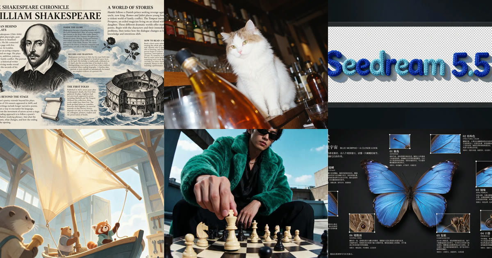

<div align="center">

<a href="https://apiko.app/ko/seedream-5-5-prompts?utm_source=github&utm_medium=banner&utm_campaign=awesome-seedream-5.5-prompts"></a>

[](LICENSE)
[](README_ko.md#menu)
[](https://apiko.app/ko/models/seedream-5.5?utm_source=github&utm_medium=badge&utm_campaign=awesome-seedream-5.5-prompts&utm_content=model_try)
[](https://apiko.app/docs/api-manual/image-series/seedream-5.5/images?utm_source=github&utm_medium=badge&utm_campaign=awesome-seedream-5.5-prompts&utm_content=docs)

[](README.md)
[](README_zh-CN.md)
[](README_zh-TW.md)
[](README_ko.md)

</div>

# Awesome Seedream 5.5 프롬프트

<a id="introduction"></a>
## 🌟 소개

**Seedream 5.5 프롬프트: ByteDance Seed, BytePlus, 크리에이터 실사용 예시 51개와 결과 이미지. 사진, 포스터 글자, 투명 PNG, 캐릭터 일러스트까지.**

이 페이지의 모든 결과 이미지는 Seedream 5.5로 만들었습니다. 그대로 복사하거나 플레이그라운드로 보내 세부만 바꿔 보세요.

검색과 필터는 [apiko.app/seedream-5-5-prompts](https://apiko.app/ko/seedream-5-5-prompts?utm_source=github&utm_medium=readme&utm_campaign=awesome-seedream-5.5-prompts&utm_content=intro).

> [!NOTE]
> 프롬프트는 작성자가 올린 원문 그대로라 대부분 영어입니다. 제목과 설명은 저희가 썼습니다. 모든 예시에 작성자와 원본 게시물 링크를 달았습니다.

<a id="quick-start"></a>
## 🚀 빠른 시작

**브라우저에서:** 모든 예시에 **APIKO에서 실행** 링크가 있습니다. [apiko.app](https://apiko.app/ko/seedream-5-5-prompts?utm_source=github&utm_medium=quickstart&utm_campaign=awesome-seedream-5.5-prompts&utm_content=browser)에서 해당 예시가 열리며, **사용**을 누르면 프롬프트가 Seedream 5.5 플레이그라운드에 채워집니다.

**API로:** [APIKO API 키](https://apiko.app/ko/dashboard/apikeys?utm_source=github&utm_medium=quickstart&utm_campaign=awesome-seedream-5.5-prompts&utm_content=api_key)를 만든 뒤 비동기 작업을 생성하고, 이미지가 완성될 때까지 상태를 조회합니다.

```bash
export APIKO_API_KEY="your_key_here"

TASK_ID=$(curl -s https://api.apiko.app/v1/images/generations \
  -H "Authorization: Bearer $APIKO_API_KEY" \
  -H "Content-Type: application/json" \
  -d '{
  "model": "seedream-5.5",
  "prompt": "A minimalist poster of a paper boat on a calm lake at sunrise, the title \"Morning\" in bold serif type.",
  "size": "16:9",
  "resolution": "1K",
  "async": true
}' | python3 -c 'import json,sys; print(json.load(sys.stdin)["id"])')

# When status is "completed", the image is at data[0].url (kept for 24 hours).
while :; do
  TASK=$(curl -s https://api.apiko.app/v1/tasks/$TASK_ID \
    -H "Authorization: Bearer $APIKO_API_KEY")
  printf '%s\n' "$TASK"
  printf '%s' "$TASK" | grep -qE '"status": *"(completed|failed)"|"error": *\{' && break
  sleep 5
done
```

엔드포인트: `POST https://api.apiko.app/v1/images/generations` (작업 생성) · `GET https://api.apiko.app/v1/tasks/{id}` (상태와 결과 조회)

<a id="how-to-write"></a>
## ✍️ Seedream 5.5 프롬프트 쓰는 법

이 페이지의 프롬프트에 반복해서 나오는 네 가지 구조.

- **카메라처럼 묘사하기** · `화면비 + 앵글 + 광원 + 필름이나 렌즈 + 남길 불완전함` — 실사 프롬프트는 화면(세로 3:4, 초광각, 25° 기울기), 빛(플래시, 창가 빛, 나트륨등), 원하는 그레인이나 노출 부족을 적습니다.
- **모든 글자에 따옴표** · `레이아웃 + "따옴표 속 원문" + 위계 + 다른 글자 금지` — 포스터, 라벨, 인포그래픽은 줄마다 따옴표로 묶고 위치를 정한 뒤 지어낸 글자를 금지합니다.
- **투명 배경은 문장과 설정 둘 다** · `대상 + 투명 배경 + 반투명할 부분` — 소스 프롬프트는 비울 곳, 반투명할 곳, 불투명할 곳을 나눠 적습니다. Background도 transparent로 설정하세요.
- **한 가지만 바꾸고 유지할 것을 나열** · `X를 … 로 변경 + A, B, C 그대로` — 편집 프롬프트는 바꿀 한 가지를 말한 뒤 움직이면 안 되는 요소를 나열합니다. 그래야 여러 번 고쳐도 손대지 않은 픽셀이 그대로 남습니다.

**예시에서 알 수 있는 것**

- **스냅은 한 줄이면 됩니다.** "폰으로 찍은, 아주 사실적인, 눈 내리는 베이징 후퉁" 같은 한 줄로 카메라 설정 없이도 실사 같은 거리 사진이 나왔습니다.
- **작은 중국어 글자도 읽힙니다.** 모르포나비 인포그래픽, 스토리보드, 밈 시트에 작은 중국어 라벨이 많습니다. 인쇄 전에는 글자마다 확인하세요.
- **그리드는 한 캐릭터를 유지합니다.** 턴어라운드 시트, 6컷 스토리보드, 3×3 밈 시트는 칸마다 같은 얼굴, 옷, 조명을 요구합니다.
- **참고 이미지가 스타일을 정합니다.** 털실 글자와 올빼미 매크로는 업로드한 이미지에서 질감과 구도를 가져옵니다. 참고 이미지가 필요한 카드에는 직접 이미지를 올리세요.

<a id="menu"></a>
## 📑 목차

- [• 사진](#photography) (19)
  - [밤 바의 흰 고양이, 플래시와 프로비아 필름](#photography-01)
  - [창가 빛 속 아기를 안고 쉬는 아빠](#photography-02)
  - [남유럽 골목의 레몬색 벽과 보라색 문](#photography-03)
  - [25도 기울어진 바람 부는 거리 스냅](#photography-04)
  - [여름 저녁 유럽 비스트로의 노부부](#photography-05)
  - [빗물 웅덩이에 비친 금빛 건물](#photography-06)
  - [지하철 승강장의 모션 블러 인파](#photography-07)
  - [초광각: 울타리 틈으로 보는 당나귀](#photography-08)
  - [수영장에서 seedream 글자를 이룬 물방울](#photography-09)
  - [옥상 체스 초저각, 거대한 킹 말](#photography-10)
  - [세 언어 간판이 있는 런던 밤거리 가게](#photography-11)
  - [눈물 맺힌 눈 매크로와 유리 위 작은 글자](#photography-12)
  - [블루아워에 그물을 깁는 노어부](#photography-13)
  - [90년대 소련 버스 옆 겨울 화보](#photography-14)
  - [지하철 에스컬레이터에서 돌아보는 인물](#photography-15)
  - [폰 스냅: 눈 내린 베이징 후퉁](#photography-16)
  - [폰 스냅: 베이징 외곽의 제설 미화원](#photography-17)
  - [폰 스냅: 눈 내린 톈진 하이허 강변](#photography-18)
  - [60분간 녹는 얼음 속 데이지 6컷](#photography-19)
- [• 글자, 포스터, 디자인](#text-design) (11)
  - [문학 특집 신문 셰익스피어 크로니클](#text-design-01)
  - [거리 인쇄 주제의 그라피티 콜라주 포스터](#text-design-02)
  - [인포그래픽 포스터 From Seed to Salad](#text-design-03)
  - [중영 이중 언어 모르포나비 인포그래픽](#text-design-04)
  - [작은 글자가 빼곡한 잡지 표지](#text-design-05)
  - [작은 글자가 있는 세럼 패키지 목업](#text-design-06)
  - [스위스 스타일 공연 포스터 Night Signal](#text-design-07)
  - [가상의 심해 장어 도감 페이지](#text-design-08)
  - [화면 녹화 앱 아이콘 10가지 스타일](#text-design-09)
  - [숏드라마 표지 '13층': 어두운 복도](#text-design-10)
  - [부푼 풍선 3D 글자 '夯爆了'](#text-design-11)
- [• 투명 PNG와 편집](#transparent-assets) (12)
  - [달리는 소녀, 프레임마다 투명 레이어](#transparent-assets-01)
  - [투명 배경의 만화 스티커 두 세트](#transparent-assets-02)
  - [파란 털실로 감은 Seedream 5.5 글자](#transparent-assets-03)
  - [봉제 캐릭터 넷, 각각 투명 PNG](#transparent-assets-04)
  - [편집: 분홍 풍선껌 불기, 나머지 유지](#transparent-assets-05)
  - [음악 플레이어 UI가 있는 크리스마스 아크릴 스탠드](#transparent-assets-06)
  - [두 사진에서 스티커를 뽑아 투명 시트로](#transparent-assets-07)
  - [반투명 유리 해파리 램프](#transparent-assets-08)
  - [호박색 향수병 투명 소스](#transparent-assets-09)
  - [전신 스트리트웨어 누끼 소스](#transparent-assets-10)
  - [반투명 아크릴판을 든 손](#transparent-assets-11)
  - [오버레이용 크롬 리본 로고](#transparent-assets-12)
- [• 일러스트와 캐릭터](#illustration-characters) (9)
  - [과슈 그림책: 구름바다 글라이더 공방](#illustration-characters-01)
  - [블루베리 캐릭터 보드 BERRY CLUB](#illustration-characters-02)
  - [무지개 우산을 든 페이퍼 퀼링 무용수](#illustration-characters-03)
  - [한푸 차림 여의사 턴어라운드 시트](#illustration-characters-04)
  - [컬러 팔레트가 있는 애니 캐릭터 카드](#illustration-characters-05)
  - [샷 크기를 적은 6컷 스토리보드](#illustration-characters-06)
  - [같은 시각 마을 안팎 2컷](#illustration-characters-07)
  - [고래꼬리 소녀 3×3 밈 시트](#illustration-characters-08)
  - [펠트 질감 고래꼬리 소녀 피규어](#illustration-characters-09)
- [❓ 자주 묻는 질문](#faq)
- [🔗 관련 링크](#related)

<a id="photography"></a>
## • 사진

> 거리, 다큐, 인물, 폰 스냅으로 빛과 피부, 재질을 봅니다. · 19개

<a id="photography-01"></a>
### 1. 밤 바의 흰 고양이, 플래시와 프로비아 필름

작성자 [@ByteDance Seed](https://seed.bytedance.com/en/seedream5_5) · 3:2 · **[▶ APIKO에서 실행](https://apiko.app/ko/seedream-5-5-prompts?utm_source=github&utm_medium=case&utm_campaign=awesome-seedream-5.5-prompts&utm_content=photography-01#photography-01)** · [원본 게시물](https://seed.bytedance.com/en/seedream5_5)

<a href="https://apiko.app/ko/seedream-5-5-prompts?utm_source=github&utm_medium=case&utm_campaign=awesome-seedream-5.5-prompts&utm_content=photography-01#photography-01"></a>

**프롬프트:**

```text
A white cat sits elegantly among bottles and glasses in a bar at night. Shoot from a low angle with a tilted composition, using flash, Fujifilm Provia colors and film grain. Capture dappled light, bright highlights and crisp detail for a vintage photographic feel.
```

<a id="photography-02"></a>
### 2. 창가 빛 속 아기를 안고 쉬는 아빠

작성자 [@ByteDance Seed](https://seed.bytedance.com/en/seedream5_5) · 16:9 · **[▶ APIKO에서 실행](https://apiko.app/ko/seedream-5-5-prompts?utm_source=github&utm_medium=case&utm_campaign=awesome-seedream-5.5-prompts&utm_content=photography-02#photography-02)** · [원본 게시물](https://seed.bytedance.com/en/seedream5_5)

<a href="https://apiko.app/ko/seedream-5-5-prompts?utm_source=github&utm_medium=case&utm_campaign=awesome-seedream-5.5-prompts&utm_content=photography-02#photography-02"></a>

**프롬프트:**

```text
A warm documentary photograph of a young father reclining on a dark purple-gray fabric sofa, holding a sleeping baby. Cream knitted cushions and a mustard-yellow blanket show soft, tactile fabric textures. Warm golden daylight enters through a window on the right. Relaxed poses, natural skin tones, gentle shadows and film grain capture a quiet, intimate afternoon.
```

<a id="photography-03"></a>
### 3. 남유럽 골목의 레몬색 벽과 보라색 문

작성자 [@ByteDance Seed](https://seed.bytedance.com/en/seedream5_5) · 3:4 · **[▶ APIKO에서 실행](https://apiko.app/ko/seedream-5-5-prompts?utm_source=github&utm_medium=case&utm_campaign=awesome-seedream-5.5-prompts&utm_content=photography-03#photography-03)** · [원본 게시물](https://seed.bytedance.com/en/seedream5_5)

<a href="https://apiko.app/ko/seedream-5-5-prompts?utm_source=github&utm_medium=case&utm_campaign=awesome-seedream-5.5-prompts&utm_content=photography-03#photography-03"></a>

**프롬프트:**

```text
A vertical 3:4 street photograph of a southern European corner. A lemon-yellow limewashed wall, an old deep-purple wooden door and hanging royal-purple linen form a bold geometric composition. Golden flowers fill a weathered metal bucket at the lower right. Strong afternoon sunlight casts crisp shadows, revealing textured plaster, fabric folds, rust and layered petals in vivid complementary purple and yellow.
```

<a id="photography-04"></a>
### 4. 25도 기울어진 바람 부는 거리 스냅

작성자 [@ByteDance Seed](https://seed.bytedance.com/en/seedream5_5) · 16:9 · **[▶ APIKO에서 실행](https://apiko.app/ko/seedream-5-5-prompts?utm_source=github&utm_medium=case&utm_campaign=awesome-seedream-5.5-prompts&utm_content=photography-04#photography-04)** · [원본 게시물](https://seed.bytedance.com/en/seedream5_5)

<a href="https://apiko.app/ko/seedream-5-5-prompts?utm_source=github&utm_medium=case&utm_campaign=awesome-seedream-5.5-prompts&utm_content=photography-04#photography-04"></a>

**프롬프트:**

```text
A candid horizontal street photograph of a long-haired woman in a burgundy top and light brown jacket looking down at her phone. Strong wind sweeps her hair across her sunglasses and face. The entire frame tilts about 25 degrees clockwise, with consistent perspective across the figure, buildings, lamppost and pavement. Natural clothing folds, hurried framing and asymmetric cropping create an unposed everyday moment.
```

<a id="photography-05"></a>
### 5. 여름 저녁 유럽 비스트로의 노부부

작성자 [@ByteDance Seed](https://seed.bytedance.com/en/seedream5_5) · 16:9 · **[▶ APIKO에서 실행](https://apiko.app/ko/seedream-5-5-prompts?utm_source=github&utm_medium=case&utm_campaign=awesome-seedream-5.5-prompts&utm_content=photography-05#photography-05)** · [원본 게시물](https://seed.bytedance.com/en/seedream5_5)

<a href="https://apiko.app/ko/seedream-5-5-prompts?utm_source=github&utm_medium=case&utm_campaign=awesome-seedream-5.5-prompts&utm_content=photography-05#photography-05"></a>

**프롬프트:**

```text
A candid horizontal snapshot inside a neighborhood bistro in Europe on a summer evening. Two older diners eat naturally at a table covered with cream linen, unaware of the camera. Glasses, cutlery, breadcrumbs and worn wooden furniture show everyday use. Warm pendant lights mix with traces of cool evening light. Slight underexposure, subtle high-ISO grain and foreground occlusion create an intimate, spontaneous atmosphere.
```

<a id="photography-06"></a>
### 6. 빗물 웅덩이에 비친 금빛 건물

작성자 [@ByteDance Seed](https://seed.bytedance.com/en/seedream5_5) · 3:4 · **[▶ APIKO에서 실행](https://apiko.app/ko/seedream-5-5-prompts?utm_source=github&utm_medium=case&utm_campaign=awesome-seedream-5.5-prompts&utm_content=photography-06#photography-06)** · [원본 게시물](https://seed.bytedance.com/en/seedream5_5)

<a href="https://apiko.app/ko/seedream-5-5-prompts?utm_source=github&utm_medium=case&utm_campaign=awesome-seedream-5.5-prompts&utm_content=photography-06#photography-06"></a>

**프롬프트:**

```text
A vertical 3:4 street photograph after rain, taken from a low angle looking down at wet paving stones and irregular puddles. Reflections of an old building’s golden carvings, window frames and colonnades are fragmented by exposed stones, puddle edges and ripples. Warm golden light contrasts with deep-blue reflections, preserving worn joints and wet surface textures. No full building, people or vehicles appear.
```

<a id="photography-07"></a>
### 7. 지하철 승강장의 모션 블러 인파

작성자 [@ByteDance Seed](https://seed.bytedance.com/en/seedream5_5) · 3:2 · **[▶ APIKO에서 실행](https://apiko.app/ko/seedream-5-5-prompts?utm_source=github&utm_medium=case&utm_campaign=awesome-seedream-5.5-prompts&utm_content=photography-07#photography-07)** · [원본 게시물](https://seed.bytedance.com/en/seedream5_5)

<a href="https://apiko.app/ko/seedream-5-5-prompts?utm_source=github&utm_medium=case&utm_campaign=awesome-seedream-5.5-prompts&utm_content=photography-07#photography-07"></a>

**프롬프트:**

```text
Photograph a busy modern city subway platform filled with Asian commuters walking briskly in orderly flows. Use central perspective, with the platform, yellow safety lines and overhead lights receding into the distance. Combine motion blur, soft diffuse light and a subtle glow while retaining highlight and shadow detail to convey the energy of urban life.
```

<a id="photography-08"></a>
### 8. 초광각: 울타리 틈으로 보는 당나귀

작성자 [@ByteDance Seed](https://seed.bytedance.com/en/seedream5_5) · 16:9 · **[▶ APIKO에서 실행](https://apiko.app/ko/seedream-5-5-prompts?utm_source=github&utm_medium=case&utm_campaign=awesome-seedream-5.5-prompts&utm_content=photography-08#photography-08)** · [원본 게시물](https://seed.bytedance.com/en/seedream5_5)

<a href="https://apiko.app/ko/seedream-5-5-prompts?utm_source=github&utm_medium=case&utm_campaign=awesome-seedream-5.5-prompts&utm_content=photography-08#photography-08"></a>

**프롬프트:**

```text
A horizontal ultra-wide-angle photograph of a curious gray-brown donkey peering through a vertical gap in a weathered wooden fence. Its broad muzzle nearly touches the lens, while its eyes and long ears recede in exaggerated close-up perspective. Focus on the muzzle’s fine hair, whiskers and skin texture, with softly blurred fence boards, blue sky and grass beyond. Natural daylight creates a playful candid moment.
```

<a id="photography-09"></a>
### 9. 수영장에서 seedream 글자를 이룬 물방울

작성자 [@ByteDance Seed](https://seed.bytedance.com/en/seedream5_5) · 2:3 · **[▶ APIKO에서 실행](https://apiko.app/ko/seedream-5-5-prompts?utm_source=github&utm_medium=case&utm_campaign=awesome-seedream-5.5-prompts&utm_content=photography-09#photography-09)** · [원본 게시물](https://seed.bytedance.com/en/seedream5_5)

<a href="https://apiko.app/ko/seedream-5-5-prompts?utm_source=github&utm_medium=case&utm_campaign=awesome-seedream-5.5-prompts&utm_content=photography-09#photography-09"></a>

**프롬프트:**

```text
A hand lifts a string of water droplets from a miniature swimming pool. The droplets spell “seedream” vertically. Surreal summer photography with vivid colors and a film-like texture.
```

<a id="photography-10"></a>
### 10. 옥상 체스 초저각, 거대한 킹 말

작성자 [@MayorKingAI](https://x.com/MayorKingAI) · 4:5 · **[▶ APIKO에서 실행](https://apiko.app/ko/seedream-5-5-prompts?utm_source=github&utm_medium=case&utm_campaign=awesome-seedream-5.5-prompts&utm_content=photography-10#photography-10)** · [원본 게시물](https://x.com/MayorKingAI/status/2120198834508955990)

<a href="https://apiko.app/ko/seedream-5-5-prompts?utm_source=github&utm_medium=case&utm_campaign=awesome-seedream-5.5-prompts&utm_content=photography-10#photography-10"></a>

**프롬프트:**

```text
An ultra-realistic high-fashion editorial photograph of a striking 28-year-old Japanese man with sharp facial features, a defined jawline, slightly messy medium-length black hair and narrow rectangular black sunglasses, sitting confidently on a rooftop terrace while playing chess.

He wears an oversized luxurious emerald-green faux-fur coat over a black silk shirt, tailored black trousers and a subtle silver chain necklace. His expression is calm, confident and slightly intimidating, looking directly toward the camera.

Camera composition: An extreme low-angle shot taken from the very edge of a chessboard, with the camera positioned only a few centimeters above the board's surface. The black-and-white chessboard dominates the entire bottom third of the frame, its squares appearing exceptionally large in the foreground and rapidly shrinking toward the seated man.

The man is centered in the composition, visible from approximately the knees upward, leaning slightly forward. His right arm extends directly toward the camera, with his hand dramatically enlarged by perspective. He is gripping the top of a polished ivory wooden king chess piece between his thumb and index finger, moving it toward an empty square near the camera. The king is dramatically oversized in the immediate foreground due to the wide-angle perspective, while the remaining chess pieces appear progressively smaller toward the background.

His other hand rests naturally near his knee. The chess pieces are physically accurate and positioned naturally on the board, with realistic contact shadows and detailed polished wooden surfaces.

Environment: An open urban rooftop with subtle concrete architectural details, low surrounding rooftops and an enormous vivid cyan-blue sky with a few soft, scattered white clouds. The bright sky occupies the upper half of the composition, creating strong visual contrast against the emerald-green coat.

Photography: Shot on a Sony A1 II with a 20mm wide-angle lens, camera placed at chessboard level, f/8, ISO 100, 1/1000s. Deep environmental perspective, exaggerated foreground scale, realistic optical distortion, crisp textures across the chessboard and subject. Bright natural midday sunlight, accurate skin tones, natural facial asymmetry, individual hair strands, detailed fabric and fur fibers, subtle imperfections and physically realistic shadows.

Authentic luxury fashion campaign photography, bold editorial framing, natural photographic color grading, exceptionally realistic skin texture, no artificial skin smoothing, no CGI appearance, no illustration, no plastic textures, no excessive cinematic effects.
```

<a id="photography-11"></a>
### 11. 세 언어 간판이 있는 런던 밤거리 가게

작성자 [@Dheepanratnam](https://x.com/Dheepanratnam) · 16:9 · **[▶ APIKO에서 실행](https://apiko.app/ko/seedream-5-5-prompts?utm_source=github&utm_medium=case&utm_campaign=awesome-seedream-5.5-prompts&utm_content=photography-11#photography-11)** · [원본 게시물](https://x.com/Dheepanratnam/status/2119767938173387065)

<a href="https://apiko.app/ko/seedream-5-5-prompts?utm_source=github&utm_medium=case&utm_campaign=awesome-seedream-5.5-prompts&utm_content=photography-11#photography-11"></a>

**프롬프트:**

```text
Photorealistic street scene in a multicultural London neighbourhood at night. A shopfront sign reads exactly “OPEN LATE” in English, with a smaller hanging sign reading exactly “欢迎光临” in simplified Chinese and another small poster reading exactly “Bienvenue” in French. Realistic neon glow, legible typography, correct character shapes, no duplicated letters, no warped glyphs, natural perspective on the signs, cinematic night photography, wet pavement reflections, no extra invented text.
```

<a id="photography-12"></a>
### 12. 눈물 맺힌 눈 매크로와 유리 위 작은 글자

작성자 [@Yuziyyaa](https://x.com/Yuziyyaa) · 1:1 · **[▶ APIKO에서 실행](https://apiko.app/ko/seedream-5-5-prompts?utm_source=github&utm_medium=case&utm_campaign=awesome-seedream-5.5-prompts&utm_content=photography-12#photography-12)** · [원본 게시물](https://x.com/Yuziyyaa/status/2119799602580955179)

<a href="https://apiko.app/ko/seedream-5-5-prompts?utm_source=github&utm_medium=case&utm_campaign=awesome-seedream-5.5-prompts&utm_content=photography-12#photography-12"></a>

**프롬프트:**

```text
电影感极致特写，年轻女性的一只眼睛占据画面中心，下眼睑挂着一颗即将落下的泪珠，泪珠有真实折射、内部高光和边缘表面张力。虹膜呈深棕色纤维纹理，瞳孔因光线略微放大，睫毛湿润粘连且根根可辨。几缕深色湿润发丝从上方垂落横过眼睛，发丝边缘被逆光打透呈金边，每根有独立厚度与细微毛躁。皮肤可见毛孔、绒毛与自然油光差异。画面右下角有一小片透明玻璃片，玻璃上印有清晰小字“Seedream 5.5”和中文“百轮测试”，字体无崩坏。光线为戏剧性侧光+冷暖对比（面部偏暖，阴影偏冷蓝），泪珠与玻璃同时反射高光。85mm微距，浅景深，背景深蓝黑色调，超写实摄影，皮肤与液体有真实物理质感，无CG感。
```

<a id="photography-13"></a>
### 13. 블루아워에 그물을 깁는 노어부

작성자 [@ahmetmertugrul](https://x.com/ahmetmertugrul) · 16:9 · **[▶ APIKO에서 실행](https://apiko.app/ko/seedream-5-5-prompts?utm_source=github&utm_medium=case&utm_campaign=awesome-seedream-5.5-prompts&utm_content=photography-13#photography-13)** · [원본 게시물](https://x.com/ahmetmertugrul/status/2119922071916757233)

<a href="https://apiko.app/ko/seedream-5-5-prompts?utm_source=github&utm_medium=case&utm_campaign=awesome-seedream-5.5-prompts&utm_content=photography-13#photography-13"></a>

**프롬프트:**

```text
Candid documentary photo, 85mm lens, f/2. An elderly fisherman in his seventies mending a tangled orange net on a wooden dock at blue hour. Mixed lighting: cold blue ambient sky from the left, a single warm sodium-vapor streetlamp from behind creating a rim light on his white stubble and the loose net fibers. Visible pores, deep wrinkles, sun spots, slightly chapped lips, a small healed scar on his knuckle. Wet wooden planks with puddles reflecting the lamp. Light drizzle visible only in the backlight. No beauty retouching, natural film grain, slight underexposure in the shadows.
```

<a id="photography-14"></a>
### 14. 90년대 소련 버스 옆 겨울 화보

작성자 [@ZaraIrahh](https://x.com/ZaraIrahh) · 2:3 · **[▶ APIKO에서 실행](https://apiko.app/ko/seedream-5-5-prompts?utm_source=github&utm_medium=case&utm_campaign=awesome-seedream-5.5-prompts&utm_content=photography-14#photography-14)** · [원본 게시물](https://x.com/ZaraIrahh/status/2120161811571912709)

<a href="https://apiko.app/ko/seedream-5-5-prompts?utm_source=github&utm_medium=case&utm_campaign=awesome-seedream-5.5-prompts&utm_content=photography-14#photography-14"></a>

**프롬프트:**

```text
Photorealistic fashion editorial with the atmosphere of a winter morning in the early 1990s, in a Soviet-era residential neighborhood. A beautiful adult brunette woman with delicate facial features stands beside the open folding doors of an aged cream-and-red Soviet LiAZ-677 city bus. She holds a small bouquet of dried wildflowers wrapped in vintage brown kraft paper, gently gripping it with both hands in front of her thighs.

She wears an oversized charcoal wool coat, a soft ivory knitted scarf, a dark burgundy ribbed sweater, straight dark trousers and black leather winter boots. Loose dark brown hair falls naturally around her face, a few strands lifted by the freezing wind. Flushed cheeks, minimal makeup, thoughtful expression, looking slightly past the camera, shoulders gently raised against the cold.

Snow-covered pavement, compacted gray snow beside the bus wheels, frosted windows with condensation, faded red paint, weathered metal. Blurred Soviet apartment blocks and a modest bus shelter in the distance. Fine snowflakes in the air, visible breath. The delicate dried flowers add a subtle warm color accent against the muted winter surroundings.

Three-quarter portrait framed from the knees up, eye-level camera, woman placed off-center, the bus filling one side of the composition. Cold overcast daylight with direct on-camera flash, crisp face, deep background, subtle analog film grain, restrained colors, candid 1990s street photography combined with luxury fashion editorial. Real skin texture, tactile wool, believable hands and bouquet construction, shot on a 50mm lens --ar 3:4 --style raw --s 150 --no modern cars smartphones logos text watermark
```

<a id="photography-15"></a>
### 15. 지하철 에스컬레이터에서 돌아보는 인물

작성자 [@johnAGI168](https://x.com/johnAGI168) · 3:4 · **[▶ APIKO에서 실행](https://apiko.app/ko/seedream-5-5-prompts?utm_source=github&utm_medium=case&utm_campaign=awesome-seedream-5.5-prompts&utm_content=photography-15#photography-15)** · [원본 게시물](https://x.com/johnAGI168/status/2120363733713039575)

<a href="https://apiko.app/ko/seedream-5-5-prompts?utm_source=github&utm_medium=case&utm_campaign=awesome-seedream-5.5-prompts&utm_content=photography-15#photography-15"></a>

**프롬프트:**

```text
A cinematic vertical 35mm photograph captured at eye level — an evocative over-the-shoulder medium portrait of a stunning young East Asian woman looking back toward the camera while riding a dimly lit subway escalator.

She possesses delicate, melancholic beauty with expressive dark eyes and natural lips, casting an enigmatic glance over her shoulder. Her long, layered jet-black hair blows freely in the underground draft, with loose strands sweeping across her cheeks and face with realistic kinetic motion. She wears a minimalist black spaghetti-strap slip top that reveals elegant collarbones and bare shoulders.

The setting is a vintage metro tunnel with escalator railings receding into deep perspective. Overhead linear fluorescent lights glow with a soft amber-green halation bloom, while the distant terminal melts into colorful circular bokeh of red, cyan, and warm white, creating a moody, nostalgic urban atmosphere reminiscent of 90s cinema.

Shot on a fast 50mm vintage prime at f/1.4 with soft diffusion filtration and authentic 35mm film grain in an M1 cinematic narrative register. Genuine human skin with fine pores, biological warmth, realistic wind dynamics on hair, and rich color-negative film roll-off — cinematic frame, strictly no CGI, no 3D render, no plastic skin, no artificial smoothing.
```

<a id="photography-16"></a>
### 16. 폰 스냅: 눈 내린 베이징 후퉁

작성자 [@vista8](https://x.com/vista8) · 3:2 · **[▶ APIKO에서 실행](https://apiko.app/ko/seedream-5-5-prompts?utm_source=github&utm_medium=case&utm_campaign=awesome-seedream-5.5-prompts&utm_content=photography-16#photography-16)** · [원본 게시물](https://x.com/vista8/status/2120085580264714732)

<a href="https://apiko.app/ko/seedream-5-5-prompts?utm_source=github&utm_medium=case&utm_campaign=awesome-seedream-5.5-prompts&utm_content=photography-16#photography-16"></a>

**프롬프트:**

```text
手机随手拍，超真实，北京一个胡同，下雪了
```

<a id="photography-17"></a>
### 17. 폰 스냅: 베이징 외곽의 제설 미화원

작성자 [@vista8](https://x.com/vista8) · 3:2 · **[▶ APIKO에서 실행](https://apiko.app/ko/seedream-5-5-prompts?utm_source=github&utm_medium=case&utm_campaign=awesome-seedream-5.5-prompts&utm_content=photography-17#photography-17)** · [원본 게시물](https://x.com/vista8/status/2120085580264714732)

<a href="https://apiko.app/ko/seedream-5-5-prompts?utm_source=github&utm_medium=case&utm_campaign=awesome-seedream-5.5-prompts&utm_content=photography-17#photography-17"></a>

**프롬프트:**

```text
手机随手拍，北京五环外，环卫工人在扫雪，超真实
```

<a id="photography-18"></a>
### 18. 폰 스냅: 눈 내린 톈진 하이허 강변

작성자 [@vista8](https://x.com/vista8) · 3:2 · **[▶ APIKO에서 실행](https://apiko.app/ko/seedream-5-5-prompts?utm_source=github&utm_medium=case&utm_campaign=awesome-seedream-5.5-prompts&utm_content=photography-18#photography-18)** · [원본 게시물](https://x.com/vista8/status/2120085580264714732)

<a href="https://apiko.app/ko/seedream-5-5-prompts?utm_source=github&utm_medium=case&utm_campaign=awesome-seedream-5.5-prompts&utm_content=photography-18#photography-18"></a>

**프롬프트:**

```text
手机随手拍，超真实，天津海河边，下雪了
```

<a id="photography-19"></a>
### 19. 60분간 녹는 얼음 속 데이지 6컷

작성자 [@oran_ge](https://x.com/oran_ge) · 1:1 · **[▶ APIKO에서 실행](https://apiko.app/ko/seedream-5-5-prompts?utm_source=github&utm_medium=case&utm_campaign=awesome-seedream-5.5-prompts&utm_content=photography-19#photography-19)** · [원본 게시물](https://x.com/oran_ge/status/2120037929615503812)

<a href="https://apiko.app/ko/seedream-5-5-prompts?utm_source=github&utm_medium=case&utm_campaign=awesome-seedream-5.5-prompts&utm_content=photography-19#photography-19"></a>

**프롬프트:**

```text
2×3 六格，同一机位。一块方冰里冻着一朵小雏菊，放在白瓷盘上，背景深灰蓝。六格依次是 0、5、10、20、40、60 分钟：冰从完整方块，到边缘化开、体积变薄，最后只剩一摊水，雏菊一直在原来的位置。每格底部标分钟数。冷调柔光，冰要通透，能看见花被冻在里面的折射。
```

<a id="text-design"></a>
## • 글자, 포스터, 디자인

> 신문, 인포그래픽, 표지, 라벨, 아이콘처럼 글자가 정확해야 하는 작업. · 11개

<a id="text-design-01"></a>
### 20. 문학 특집 신문 셰익스피어 크로니클

작성자 [@ByteDance Seed](https://seed.bytedance.com/en/seedream5_5) · 3:2 · **[▶ APIKO에서 실행](https://apiko.app/ko/seedream-5-5-prompts?utm_source=github&utm_medium=case&utm_campaign=awesome-seedream-5.5-prompts&utm_content=text-design-01#text-design-01)** · [원본 게시물](https://seed.bytedance.com/en/seedream5_5)

<a href="https://apiko.app/ko/seedream-5-5-prompts?utm_source=github&utm_medium=case&utm_campaign=awesome-seedream-5.5-prompts&utm_content=text-design-01#text-design-01"></a>

**프롬프트:**

```text
Design a landscape literary newspaper with the masthead “THE SHAKESPEARE CHRONICLE” and the headline “WILLIAM SHAKESPEARE”. On warm ivory paper, illustrate Shakespeare and the Globe Theatre in black engraving, with muted blue clouds and waves weaving through the page. Arrange seven short articles in English around the illustrations, using bold serif headings and legible small type.
```

<a id="text-design-02"></a>
### 21. 거리 인쇄 주제의 그라피티 콜라주 포스터

작성자 [@ByteDance Seed](https://seed.bytedance.com/en/seedream5_5) · 3:4 · **[▶ APIKO에서 실행](https://apiko.app/ko/seedream-5-5-prompts?utm_source=github&utm_medium=case&utm_campaign=awesome-seedream-5.5-prompts&utm_content=text-design-02#text-design-02)** · [원본 게시물](https://seed.bytedance.com/en/seedream5_5)

<a href="https://apiko.app/ko/seedream-5-5-prompts?utm_source=github&utm_medium=case&utm_campaign=awesome-seedream-5.5-prompts&utm_content=text-design-02#text-design-02"></a>

**프롬프트:**

```text
Create a graffiti collage poster about collaborative street printing, using lime green, aubergine purple and mint over a gray-white photocopied paper texture. Oversized “PRINT PLAY!” lettering overlaps diagonally. A grayscale printmaker at the upper right holds a roller and print sample, with printing tools and handwritten phrases including “MAKE A MARK” and “PASS IT ON” below. Preserve matte halftone ink, fine grain and legible lettering in a layered, asymmetric composition.
```

<a id="text-design-03"></a>
### 22. 인포그래픽 포스터 From Seed to Salad

작성자 [@ByteDance Seed](https://seed.bytedance.com/en/seedream5_5) · 3:4 · **[▶ APIKO에서 실행](https://apiko.app/ko/seedream-5-5-prompts?utm_source=github&utm_medium=case&utm_campaign=awesome-seedream-5.5-prompts&utm_content=text-design-03#text-design-03)** · [원본 게시물](https://seed.bytedance.com/en/seedream5_5)

<a href="https://apiko.app/ko/seedream-5-5-prompts?utm_source=github&utm_medium=case&utm_campaign=awesome-seedream-5.5-prompts&utm_content=text-design-03#text-design-03"></a>

**프롬프트:**

```text
Create an illustrated infographic poster titled “FROM SEED TO SALAD” on warm-white paper with a handmade print texture. One continuous path snakes across three tiers, linking six numbered stages in order: SOW, SPROUT, GROW, TEND, HARVEST and SHARE. Five correctly directed arrows connect the sequence. Pair miniature gardening scenes and English descriptions with each stage, keeping the reading order clear, lettering legible and colors soft yet varied.
```

<a id="text-design-04"></a>
### 23. 중영 이중 언어 모르포나비 인포그래픽

작성자 [@ByteDance Seed](https://seed.bytedance.com/en/seedream5_5) · 16:9 · **[▶ APIKO에서 실행](https://apiko.app/ko/seedream-5-5-prompts?utm_source=github&utm_medium=case&utm_campaign=awesome-seedream-5.5-prompts&utm_content=text-design-04#text-design-04)** · [원본 게시물](https://seed.bytedance.com/en/seedream5_5)

<a href="https://apiko.app/ko/seedream-5-5-prompts?utm_source=github&utm_medium=case&utm_campaign=awesome-seedream-5.5-prompts&utm_content=text-design-04#text-design-04"></a>

**프롬프트:**

```text
A horizontal natural-history infographic titled “蓝闪蝶：一只蝴蝶的微观宇宙”, with the English heading “BLUE MORPHO・A CLOSER LOOK”. A large blue morpho spreads its wings against a black background, surrounded by eight macro-detail modules: antennae, structural color, wing margin, proboscis, compound eye, ventral wing, wing venation and wing scales. Pair Chinese explanations with English terms and observation notes. Preserve legible small text and fine wing textures, with a footer stating that enlarged details are illustrative and not to scale.
```

<a id="text-design-05"></a>
### 24. 작은 글자가 빼곡한 잡지 표지

작성자 [@Dheepanratnam](https://x.com/Dheepanratnam) · 16:9 · **[▶ APIKO에서 실행](https://apiko.app/ko/seedream-5-5-prompts?utm_source=github&utm_medium=case&utm_campaign=awesome-seedream-5.5-prompts&utm_content=text-design-05#text-design-05)** · [원본 게시물](https://x.com/Dheepanratnam/status/2119767938173387065)

<a href="https://apiko.app/ko/seedream-5-5-prompts?utm_source=github&utm_medium=case&utm_campaign=awesome-seedream-5.5-prompts&utm_content=text-design-05#text-design-05"></a>

**프롬프트:**

```text
Premium magazine cover design titled “THE FUTURE OF CREATIVE TOOLS”, with a realistic portrait of a stylish creative director in the lower third. Dense small cover lines around the edges: “Issue 24”, “AI Workflows”, “Design Systems”, “Cinematic Image Making”, “Inside the Studio”, “November 2026”. Clean modern serif masthead, precise kerning, crisp letterforms, editorial grid, muted cream background, subtle paper texture, high-end print-design layout. All text must be spelled exactly as written, no distorted letters, no duplicated words, no gibberish.
```

<a id="text-design-06"></a>
### 25. 작은 글자가 있는 세럼 패키지 목업

작성자 [@Dheepanratnam](https://x.com/Dheepanratnam) · 16:9 · **[▶ APIKO에서 실행](https://apiko.app/ko/seedream-5-5-prompts?utm_source=github&utm_medium=case&utm_campaign=awesome-seedream-5.5-prompts&utm_content=text-design-06#text-design-06)** · [원본 게시물](https://x.com/Dheepanratnam/status/2119767938173387065)

<a href="https://apiko.app/ko/seedream-5-5-prompts?utm_source=github&utm_medium=case&utm_campaign=awesome-seedream-5.5-prompts&utm_content=text-design-06#text-design-06"></a>

**프롬프트:**

```text
Minimalist skincare packaging mock-up on a pale stone pedestal. A frosted-glass serum bottle has a clean label reading exactly “LUMEN — BARRIER REPAIR SERUM”, with smaller text beneath: “30 ml / 1.0 fl oz”. Elegant sans-serif typography, perfectly straight label alignment, crisp small print, realistic glass refraction, soft studio lighting, subtle shadow, premium cosmetic advertising photography, no misspelled words, no extra branding, no watermark.
```

<a id="text-design-07"></a>
### 26. 스위스 스타일 공연 포스터 Night Signal

작성자 [@Dheepanratnam](https://x.com/Dheepanratnam) · 16:9 · **[▶ APIKO에서 실행](https://apiko.app/ko/seedream-5-5-prompts?utm_source=github&utm_medium=case&utm_campaign=awesome-seedream-5.5-prompts&utm_content=text-design-07#text-design-07)** · [원본 게시물](https://x.com/Dheepanratnam/status/2119767938173387065)

<a href="https://apiko.app/ko/seedream-5-5-prompts?utm_source=github&utm_medium=case&utm_campaign=awesome-seedream-5.5-prompts&utm_content=text-design-07#text-design-07"></a>

**프롬프트:**

```text
Bold gig poster for an underground electronic music night. Large headline reads exactly “NIGHT SIGNAL”, with supporting text: “Friday 27 November”, “Warehouse 9, London”, “Doors 10PM”. Experimental Swiss-style layout, high-contrast black, off-white and electric blue, grainy risograph texture, sharp geometric typography, intentional negative space, screen-print aesthetic. All words spelled exactly as specified, no extra text, no warped letters, no AI artefacts.
```

<a id="text-design-08"></a>
### 27. 가상의 심해 장어 도감 페이지

작성자 [@ahmetmertugrul](https://x.com/ahmetmertugrul) · 16:9 · **[▶ APIKO에서 실행](https://apiko.app/ko/seedream-5-5-prompts?utm_source=github&utm_medium=case&utm_campaign=awesome-seedream-5.5-prompts&utm_content=text-design-08#text-design-08)** · [원본 게시물](https://x.com/ahmetmertugrul/status/2119915956365369596)

<a href="https://apiko.app/ko/seedream-5-5-prompts?utm_source=github&utm_medium=case&utm_campaign=awesome-seedream-5.5-prompts&utm_content=text-design-08#text-design-08"></a>

**프롬프트:**

```text
A vintage naturalist field-guide page, aged cream paper with foxing stains, documenting a fictional deep-sea creature called "Lanternfin Abyssal Eel". Center: a detailed scientific ink-and-watercolor illustration of the eel with bioluminescent spots. Surrounding it, 10 numbered callout labels with thin leader lines, each with a 2-line caption in small serif type (e.g. "3. Photophore cluster — emits pulses at 490 nm to lure prey"). Top header in ornate engraved capitals: "PLATE XLVII — CREATURES OF THE MIDNIGHT ZONE". Bottom: a small data table with columns "Depth", "Length", "Lifespan", "Diet" and three rows of values, plus a tiny scale bar reading "10 cm". Flat top-down scan, every word sharp and legible.
```

<a id="text-design-09"></a>
### 28. 화면 녹화 앱 아이콘 10가지 스타일

작성자 [@vista8](https://x.com/vista8) · 16:9 · **[▶ APIKO에서 실행](https://apiko.app/ko/seedream-5-5-prompts?utm_source=github&utm_medium=case&utm_campaign=awesome-seedream-5.5-prompts&utm_content=text-design-09#text-design-09)** · [원본 게시물](https://x.com/vista8/status/2120085580264714732)

<a href="https://apiko.app/ko/seedream-5-5-prompts?utm_source=github&utm_medium=case&utm_campaign=awesome-seedream-5.5-prompts&utm_content=text-design-09#text-design-09"></a>

**프롬프트:**

```text
为一款名叫 Capwise 的录屏软件设计 10 种不同风格的 icon，扁平风格，顶级水平
```

<a id="text-design-10"></a>
### 29. 숏드라마 표지 '13층': 어두운 복도

작성자 [@oran_ge](https://x.com/oran_ge) · 9:16 · **[▶ APIKO에서 실행](https://apiko.app/ko/seedream-5-5-prompts?utm_source=github&utm_medium=case&utm_campaign=awesome-seedream-5.5-prompts&utm_content=text-design-10#text-design-10)** · [원본 게시물](https://x.com/oran_ge/status/2120037929615503812)

<a href="https://apiko.app/ko/seedream-5-5-prompts?utm_source=github&utm_medium=case&utm_campaign=awesome-seedream-5.5-prompts&utm_content=text-design-10#text-design-10"></a>

**프롬프트:**

```text
9:16 竖屏短剧封面。昏暗老楼走廊，尽头一扇半开的电梯门，门上红色 LED 楼层数字「13」是最亮的东西。三行字：顶部标题「第13层」，中部副题「短剧 · 全集上线」，底部一行「别按那个键」。红色数字要跳、字要清楚，三行字居中对称，不许压到人脸。冷绿灰调，走廊纵深要能看出景深，只有电梯里透出一点红光。
```

<a id="text-design-11"></a>
### 30. 부푼 풍선 3D 글자 '夯爆了'

작성자 [@oran_ge](https://x.com/oran_ge) · 3:4 · **[▶ APIKO에서 실행](https://apiko.app/ko/seedream-5-5-prompts?utm_source=github&utm_medium=case&utm_campaign=awesome-seedream-5.5-prompts&utm_content=text-design-11#text-design-11)** · [원본 게시물](https://x.com/oran_ge/status/2120037929615503812)

<a href="https://apiko.app/ko/seedream-5-5-prompts?utm_source=github&utm_medium=case&utm_campaign=awesome-seedream-5.5-prompts&utm_content=text-design-11#text-design-11"></a>

**프롬프트:**

```text
三个膨胀立体大字「夯爆了」，糖果色塑料气球质感，字要撑满画面，字与字之间互相挤压、有前后遮挡，边缘高光通透。浅粉橘色背景，几颗小星星和一团小烟做点缀。字体卡通、笔画圆胖。
```

<a id="transparent-assets"></a>
## • 투명 PNG와 편집

> 네이티브 RGBA 출력: 스티커, 제품 누끼, 반투명 유리, 그리고 한 곳만 바꾸고 나머지는 그대로 두는 편집. · 12개

<a id="transparent-assets-01"></a>
### 31. 달리는 소녀, 프레임마다 투명 레이어

작성자 [@ByteDance Seed](https://seed.bytedance.com/en/seedream5_5) · 2:3 · **[▶ APIKO에서 실행](https://apiko.app/ko/seedream-5-5-prompts?utm_source=github&utm_medium=case&utm_campaign=awesome-seedream-5.5-prompts&utm_content=transparent-assets-01#transparent-assets-01)** · [원본 게시물](https://seed.bytedance.com/en/seedream5_5)

<a href="https://apiko.app/ko/seedream-5-5-prompts?utm_source=github&utm_medium=case&utm_campaign=awesome-seedream-5.5-prompts&utm_content=transparent-assets-01#transparent-assets-01"></a>

**프롬프트:**

```text
Generate a sequence of images showing a girl running to the right, each on a separate layer with a transparent background.
```

<a id="transparent-assets-02"></a>
### 32. 투명 배경의 만화 스티커 두 세트

작성자 [@ByteDance Seed](https://seed.bytedance.com/en/seedream5_5) · 9:16 · **[▶ APIKO에서 실행](https://apiko.app/ko/seedream-5-5-prompts?utm_source=github&utm_medium=case&utm_campaign=awesome-seedream-5.5-prompts&utm_content=transparent-assets-02#transparent-assets-02)** · [원본 게시물](https://seed.bytedance.com/en/seedream5_5)

<a href="https://apiko.app/ko/seedream-5-5-prompts?utm_source=github&utm_medium=case&utm_campaign=awesome-seedream-5.5-prompts&utm_content=transparent-assets-02#transparent-assets-02"></a>

**프롬프트:**

```text
Generate two sets of cartoon stickers: one featuring ocean elements and cartoon cats, and the other featuring animals and plants. Keep the background transparent outside the sticker elements in both sets.
```

<a id="transparent-assets-03"></a>
### 33. 파란 털실로 감은 Seedream 5.5 글자

작성자 [@ByteDance Seed](https://seed.bytedance.com/en/seedream5_5) · 16:9 · **[▶ APIKO에서 실행](https://apiko.app/ko/seedream-5-5-prompts?utm_source=github&utm_medium=case&utm_campaign=awesome-seedream-5.5-prompts&utm_content=transparent-assets-03#transparent-assets-03)** · [원본 게시물](https://seed.bytedance.com/en/seedream5_5)

<a href="https://apiko.app/ko/seedream-5-5-prompts?utm_source=github&utm_medium=case&utm_campaign=awesome-seedream-5.5-prompts&utm_content=transparent-assets-03#transparent-assets-03"></a>

> 📎 이 예시는 참조 이미지를 직접 올려야 합니다.

**프롬프트:**

```text
Create “Seedream 5.5” inspired by the reference texture and style. Use rounded, bold sans-serif letters wrapped in alternating royal-blue and lake-blue yarn, with visible fibers, fuzz and side shadows. Use a 16:9 landscape format with a transparent background outside the lettering.
```

<a id="transparent-assets-04"></a>
### 34. 봉제 캐릭터 넷, 각각 투명 PNG

작성자 [@ByteDance Seed](https://seed.bytedance.com/en/seedream5_5) · 16:9 · **[▶ APIKO에서 실행](https://apiko.app/ko/seedream-5-5-prompts?utm_source=github&utm_medium=case&utm_campaign=awesome-seedream-5.5-prompts&utm_content=transparent-assets-04#transparent-assets-04)** · [원본 게시물](https://seed.bytedance.com/en/seedream5_5)

<a href="https://apiko.app/ko/seedream-5-5-prompts?utm_source=github&utm_medium=case&utm_campaign=awesome-seedream-5.5-prompts&utm_content=transparent-assets-04#transparent-assets-04"></a>

**프롬프트:**

```text
Create a playful blue plush 3D cartoon character with a rounded body, big eyes and short limbs. Add three characters in the same style with distinct shapes and expressions. Output each character as a separate image with a transparent background, so the four characters can be separated and combined like puzzle pieces.
```

<a id="transparent-assets-05"></a>
### 35. 편집: 분홍 풍선껌 불기, 나머지 유지

작성자 [@BytePlus ModelArk](https://docs.byteplus.com/en/docs/ModelArk/seedream-5-5) · 3:4 · **[▶ APIKO에서 실행](https://apiko.app/ko/seedream-5-5-prompts?utm_source=github&utm_medium=case&utm_campaign=awesome-seedream-5.5-prompts&utm_content=transparent-assets-05#transparent-assets-05)** · [원본 게시물](https://docs.byteplus.com/en/docs/ModelArk/seedream-5-5#multi-turn-editing-consistency)

<table>
<tr><td align="center"><a href="https://apiko.app/ko/seedream-5-5-prompts?utm_source=github&utm_medium=case&utm_campaign=awesome-seedream-5.5-prompts&utm_content=transparent-assets-05#transparent-assets-05"></a></td><td align="center"><a href="https://apiko.app/ko/seedream-5-5-prompts?utm_source=github&utm_medium=case&utm_campaign=awesome-seedream-5.5-prompts&utm_content=transparent-assets-05#transparent-assets-05"></a></td></tr>
</table>

> 📎 이 예시는 참조 이미지를 직접 올려야 합니다.

**프롬프트:**

```text
Have the person blow a round, semi-transparent pink bubblegum bubble. Preserve the identity, facial features, gaze, hairstyle, pearl earrings, clothing, pose, blue background, composition, and visual style of the person.
```

<a id="transparent-assets-06"></a>
### 36. 음악 플레이어 UI가 있는 크리스마스 아크릴 스탠드

작성자 [@BytePlus ModelArk](https://docs.byteplus.com/en/docs/ModelArk/seedream-5-5) · 2:3 · **[▶ APIKO에서 실행](https://apiko.app/ko/seedream-5-5-prompts?utm_source=github&utm_medium=case&utm_campaign=awesome-seedream-5.5-prompts&utm_content=transparent-assets-06#transparent-assets-06)** · [원본 게시물](https://docs.byteplus.com/en/docs/ModelArk/seedream-5-5#transparent-background)

<a href="https://apiko.app/ko/seedream-5-5-prompts?utm_source=github&utm_medium=case&utm_campaign=awesome-seedream-5.5-prompts&utm_content=transparent-assets-06#transparent-assets-06"></a>

**프롬프트:**

```text
A transparent acrylic standee with a Christmas theme, a rectangular outline, and a thin white edge on all sides that brings out the transparent material. Use a scrapbook collage style: place a red-and-green two-tone vinyl record with a golden rim at the center, surrounded by a dimensional Christmas wreath of acorn leaves and pine branches. Decorate the wreath with hand-drawn red berries, golden four-pointed stars, reindeer, and snowflake stickers. Overlay a minimalist white music-player UI below, with play/pause controls, a progress bar (01:24 / 04:32), and a volume icon. Use vintage red, forest green, champagne gold, and off-white. Add occasional highlights refracted by the acrylic thickness for a realistic product finish. Set a transparent background.
```

<a id="transparent-assets-07"></a>
### 37. 두 사진에서 스티커를 뽑아 투명 시트로

작성자 [@BytePlus ModelArk](https://docs.byteplus.com/en/docs/ModelArk/seedream-5-5) · 3:2 · **[▶ APIKO에서 실행](https://apiko.app/ko/seedream-5-5-prompts?utm_source=github&utm_medium=case&utm_campaign=awesome-seedream-5.5-prompts&utm_content=transparent-assets-07#transparent-assets-07)** · [원본 게시물](https://docs.byteplus.com/en/docs/ModelArk/seedream-5-5#transparent-background)

<table>
<tr><td align="center"><a href="https://apiko.app/ko/seedream-5-5-prompts?utm_source=github&utm_medium=case&utm_campaign=awesome-seedream-5.5-prompts&utm_content=transparent-assets-07#transparent-assets-07"></a></td><td align="center"><a href="https://apiko.app/ko/seedream-5-5-prompts?utm_source=github&utm_medium=case&utm_campaign=awesome-seedream-5.5-prompts&utm_content=transparent-assets-07#transparent-assets-07"></a></td><td align="center"><a href="https://apiko.app/ko/seedream-5-5-prompts?utm_source=github&utm_medium=case&utm_campaign=awesome-seedream-5.5-prompts&utm_content=transparent-assets-07#transparent-assets-07"></a></td></tr>
</table>

> 📎 이 예시는 참조 이미지를 직접 올려야 합니다.

**프롬프트:**

```text
Extract the sticker elements from Image 1 and Image 2 separately, then place all extracted stickers in one transparent-background image. Preserve each sticker's original text, colors, shapes, and details; remove all background content other than the stickers. Arrange the stickers separately without overlap, with sharp and intact edges.
```

<a id="transparent-assets-08"></a>
### 38. 반투명 유리 해파리 램프

작성자 [@ahmetmertugrul](https://x.com/ahmetmertugrul) · 16:9 · **[▶ APIKO에서 실행](https://apiko.app/ko/seedream-5-5-prompts?utm_source=github&utm_medium=case&utm_campaign=awesome-seedream-5.5-prompts&utm_content=transparent-assets-08#transparent-assets-08)** · [원본 게시물](https://x.com/ahmetmertugrul/status/2119920477535719739)

<a href="https://apiko.app/ko/seedream-5-5-prompts?utm_source=github&utm_medium=case&utm_campaign=awesome-seedream-5.5-prompts&utm_content=transparent-assets-08#transparent-assets-08"></a>

**프롬프트:**

```text
Transparent background, PNG with alpha channel. A hand-blown glass jellyfish lamp floating in mid-air: semi-transparent frosted bell with visible internal air bubbles, long trailing tentacles made of thin glass threads that fade from fully opaque at the top to almost invisible at the tips, a faint warm amber glow inside the bell, soft caustic refractions, wisps of translucent steam drifting from the tentacle ends. No background, no ground shadow, clean anti-aliased edges, studio product lighting.
```

<a id="transparent-assets-09"></a>
### 39. 호박색 향수병 투명 소스

작성자 [@Dheepanratnam](https://x.com/Dheepanratnam) · 1:1 · **[▶ APIKO에서 실행](https://apiko.app/ko/seedream-5-5-prompts?utm_source=github&utm_medium=case&utm_campaign=awesome-seedream-5.5-prompts&utm_content=transparent-assets-09#transparent-assets-09)** · [원본 게시물](https://x.com/Dheepanratnam/status/2119775195573481859)

<a href="https://apiko.app/ko/seedream-5-5-prompts?utm_source=github&utm_medium=case&utm_campaign=awesome-seedream-5.5-prompts&utm_content=transparent-assets-09#transparent-assets-09"></a>

**프롬프트:**

```text
Studio product asset of a translucent amber glass perfume bottle with a brushed-gold cap, floating centred in the frame. Fully transparent background with native alpha channel, clean accurate edges around the glass, cap and reflections, no background colour bleed, no white halo, no cut-off shadows. Preserve realistic glass refraction and internal liquid. Commercial e-commerce asset, front-facing composition, high detail, suitable for direct placement onto any design background.
```

<a id="transparent-assets-10"></a>
### 40. 전신 스트리트웨어 누끼 소스

작성자 [@Dheepanratnam](https://x.com/Dheepanratnam) · 2:3 · **[▶ APIKO에서 실행](https://apiko.app/ko/seedream-5-5-prompts?utm_source=github&utm_medium=case&utm_campaign=awesome-seedream-5.5-prompts&utm_content=transparent-assets-10#transparent-assets-10)** · [원본 게시물](https://x.com/Dheepanratnam/status/2119775195573481859)

<a href="https://apiko.app/ko/seedream-5-5-prompts?utm_source=github&utm_medium=case&utm_campaign=awesome-seedream-5.5-prompts&utm_content=transparent-assets-10#transparent-assets-10"></a>

**프롬프트:**

```text
Full-body cut-out asset of a stylish young Black male streetwear model wearing an oversized charcoal puffer jacket, baggy denim jeans and white trainers, walking casually. Fully transparent background with native alpha channel, precise edges around curly hair, jacket fibres, shoelaces and fingers, no background remnants, no halo, no clipped limbs. Natural stance, studio-quality lighting from front left, suitable for compositing into a fashion campaign.
```

<a id="transparent-assets-11"></a>
### 41. 반투명 아크릴판을 든 손

작성자 [@Dheepanratnam](https://x.com/Dheepanratnam) · 1:1 · **[▶ APIKO에서 실행](https://apiko.app/ko/seedream-5-5-prompts?utm_source=github&utm_medium=case&utm_campaign=awesome-seedream-5.5-prompts&utm_content=transparent-assets-11#transparent-assets-11)** · [원본 게시물](https://x.com/Dheepanratnam/status/2119775195573481859)

<a href="https://apiko.app/ko/seedream-5-5-prompts?utm_source=github&utm_medium=case&utm_campaign=awesome-seedream-5.5-prompts&utm_content=transparent-assets-11#transparent-assets-11"></a>

**프롬프트:**

```text
PNG asset of a hand holding a clear acrylic sheet with a subtle frosted edge, photographed straight on. The acrylic sheet must have realistic partial transparency, visible refraction and a soft translucent gradient, while the hand and fingers remain fully opaque. Native alpha channel, clean anti-aliased edges, no background, no colour contamination, no harsh cut-out edges. Premium UI/design asset, centred composition.
```

<a id="transparent-assets-12"></a>
### 42. 오버레이용 크롬 리본 로고

작성자 [@Dheepanratnam](https://x.com/Dheepanratnam) · 1:1 · **[▶ APIKO에서 실행](https://apiko.app/ko/seedream-5-5-prompts?utm_source=github&utm_medium=case&utm_campaign=awesome-seedream-5.5-prompts&utm_content=transparent-assets-12#transparent-assets-12)** · [원본 게시물](https://x.com/Dheepanratnam/status/2119775195573481859)

<a href="https://apiko.app/ko/seedream-5-5-prompts?utm_source=github&utm_medium=case&utm_campaign=awesome-seedream-5.5-prompts&utm_content=transparent-assets-12#transparent-assets-12"></a>

**프롬프트:**

```text
Transparent PNG asset of a floating 3D chrome ribbon logo shape, elegantly twisted like liquid metal, with realistic specular highlights and soft internal reflections. Fully transparent background, native alpha channel, crisp edges around every curve, no background glow, no rectangular bounding artefacts, no drop shadow baked in. Minimal premium brand asset, centred, suitable for overlaying on video or web design.
```

<a id="illustration-characters"></a>
## • 일러스트와 캐릭터

> 그림책, 캐릭터 시트, 스토리보드, 3×3 밈 시트, 피규어 디자인. · 9개

<a id="illustration-characters-01"></a>
### 43. 과슈 그림책: 구름바다 글라이더 공방

작성자 [@ByteDance Seed](https://seed.bytedance.com/en/seedream5_5) · 3:4 · **[▶ APIKO에서 실행](https://apiko.app/ko/seedream-5-5-prompts?utm_source=github&utm_medium=case&utm_campaign=awesome-seedream-5.5-prompts&utm_content=illustration-characters-01#illustration-characters-01)** · [원본 게시물](https://seed.bytedance.com/en/seedream5_5)

<a href="https://apiko.app/ko/seedream-5-5-prompts?utm_source=github&utm_medium=case&utm_campaign=awesome-seedream-5.5-prompts&utm_content=illustration-characters-01#illustration-characters-01"></a>

**프롬프트:**

```text
A fantasy picture-book illustration with delicate gouache textures, set in a cloud-sea glider workshop. A bear mechanic steadies the mast, a red panda pilot pulls the sail rope from inside the boat, and an otter assistant approaches in the foreground carrying a wooden securing pin. A low, upward-looking view and gently tilted perspective emphasize the bow, triangular sail and tall timber roof. Cream, deep teal and honey-colored wood create a bright, warm scene of teamwork.
```

<a id="illustration-characters-02"></a>
### 44. 블루베리 캐릭터 보드 BERRY CLUB

작성자 [@ByteDance Seed](https://seed.bytedance.com/en/seedream5_5) · 3:4 · **[▶ APIKO에서 실행](https://apiko.app/ko/seedream-5-5-prompts?utm_source=github&utm_medium=case&utm_campaign=awesome-seedream-5.5-prompts&utm_content=illustration-characters-02#illustration-characters-02)** · [원본 게시물](https://seed.bytedance.com/en/seedream5_5)

<a href="https://apiko.app/ko/seedream-5-5-prompts?utm_source=github&utm_medium=case&utm_campaign=awesome-seedream-5.5-prompts&utm_content=illustration-characters-02#illustration-characters-02"></a>

**프롬프트:**

```text
Design a vertical blueberry collectible-character board with sky-blue and cream cloud-shaped sections. Use the title “BERRY CLUB” and the Chinese tagline “小小一颗，慢慢快乐”. Feature the main character “莓小蓝” alongside four themed variants: MAIL RUNNER, RAINY DAY, STAR GUARDIAN and BLUEBERRY CHEF. Below, arrange front, side and back views, five expressions and six accessories. Keep consistent character proportions, matte vinyl textures and rounded bilingual typography in a rich, orderly layout.
```

<a id="illustration-characters-03"></a>
### 45. 무지개 우산을 든 페이퍼 퀼링 무용수

작성자 [@yourPlugAI](https://x.com/yourPlugAI) · 2:3 · **[▶ APIKO에서 실행](https://apiko.app/ko/seedream-5-5-prompts?utm_source=github&utm_medium=case&utm_campaign=awesome-seedream-5.5-prompts&utm_content=illustration-characters-03#illustration-characters-03)** · [원본 게시물](https://x.com/yourPlugAI/status/2120176960999403776)

<a href="https://apiko.app/ko/seedream-5-5-prompts?utm_source=github&utm_medium=case&utm_campaign=awesome-seedream-5.5-prompts&utm_content=illustration-characters-03#illustration-characters-03"></a>

**프롬프트:**

```text
3D paper quilling art of a graceful woman dancing in side-profile. She wears an elegant sleeveless v-neck dress made of intricately coiled paper strips in a vivid rainbow gradient—transitioning seamlessly through yellow, orange, red, magenta, deep purple, royal blue, and emerald green. 

Her long brown hair flows in the wind behind her as she gracefully holds an open quilled umbrella featuring matching rainbow paper panels overhead. She wears bright red high heels, standing atop quilled paper water ripples reflecting vibrant hues. Surrounding her in mid-air are multiple detailed quilled paper butterflies in shades of bright orange, yellow, pink, and sky blue. 

The background is a solid matte dark charcoal grey cardstock, featuring subtle overhead studio directional lighting that casts soft 3D drop shadows underneath the layered paper elements, emphasizing realistic texture and depth. High detail, paper craft sculpture aesthetic, 4k resolution. --ar 2:3
```

<a id="illustration-characters-04"></a>
### 46. 한푸 차림 여의사 턴어라운드 시트

작성자 [@oran_ge](https://x.com/oran_ge) · 16:9 · **[▶ APIKO에서 실행](https://apiko.app/ko/seedream-5-5-prompts?utm_source=github&utm_medium=case&utm_campaign=awesome-seedream-5.5-prompts&utm_content=illustration-characters-04#illustration-characters-04)** · [원본 게시물](https://x.com/oran_ge/status/2120037929615503812)

<a href="https://apiko.app/ko/seedream-5-5-prompts?utm_source=github&utm_medium=case&utm_campaign=awesome-seedream-5.5-prompts&utm_content=illustration-characters-04#illustration-characters-04"></a>

**프롬프트:**

```text
角色设定稿，浅灰白底，竖版。正面、四分之三侧、背面三个全身视图并排，身高比例一致，脚底在同一条线上。人物：二十二岁女医，浅青色交领短半臂加素色长裙，发髻插一支木簪。三视图下方排三个表情头：平静、微忧、含泪。最底部一行标注「沈昭 · 医女 · 二十二岁」。线稿干净、淡彩上色，旁边加一点植物线描做边饰。
```

<a id="illustration-characters-05"></a>
### 47. 컬러 팔레트가 있는 애니 캐릭터 카드

작성자 [@oran_ge](https://x.com/oran_ge) · 16:9 · **[▶ APIKO에서 실행](https://apiko.app/ko/seedream-5-5-prompts?utm_source=github&utm_medium=case&utm_campaign=awesome-seedream-5.5-prompts&utm_content=illustration-characters-05#illustration-characters-05)** · [원본 게시물](https://x.com/oran_ge/status/2120037929615503812)

<a href="https://apiko.app/ko/seedream-5-5-prompts?utm_source=github&utm_medium=case&utm_campaign=awesome-seedream-5.5-prompts&utm_content=illustration-characters-05#illustration-characters-05"></a>

**프롬프트:**

```text
漫剧人设卡，浅灰底，竖版。同一位角色三个视图：正面、四分之三侧、背面，白发、眼下有一颗小痣、深蓝连帽外套、校服裤。右侧竖排色卡，写上「主色 · 辅色」并给出三个色块。底部标注「林夜 · 十七岁 · 高中生」。二次元赛璐璐上色，边缘线干净，不要多余装饰。
```

<a id="illustration-characters-06"></a>
### 48. 샷 크기를 적은 6컷 스토리보드

작성자 [@oran_ge](https://x.com/oran_ge) · 16:9 · **[▶ APIKO에서 실행](https://apiko.app/ko/seedream-5-5-prompts?utm_source=github&utm_medium=case&utm_campaign=awesome-seedream-5.5-prompts&utm_content=illustration-characters-06#illustration-characters-06)** · [원본 게시물](https://x.com/oran_ge/status/2120037929615503812)

<a href="https://apiko.app/ko/seedream-5-5-prompts?utm_source=github&utm_medium=case&utm_campaign=awesome-seedream-5.5-prompts&utm_content=illustration-characters-06#illustration-characters-06"></a>

**프롬프트:**

```text
六格分镜故事板，2 行 3 列，同一角色同一服装同一场景。每格左上角标镜号 1–6，格下一行标注景别：1 全景、2 中景、3 近景、4 特写、5 大特写、6 仰拍（低角度从下往上拍人物）。铅笔线稿风格，淡彩上色，纸面有轻微纸纹，格与格之间用细线分隔。标注文字必须是中文，不要错字。
```

<a id="illustration-characters-07"></a>
### 49. 같은 시각 마을 안팎 2컷

작성자 [@oran_ge](https://x.com/oran_ge) · 16:9 · **[▶ APIKO에서 실행](https://apiko.app/ko/seedream-5-5-prompts?utm_source=github&utm_medium=case&utm_campaign=awesome-seedream-5.5-prompts&utm_content=illustration-characters-07#illustration-characters-07)** · [원본 게시물](https://x.com/oran_ge/status/2120037929615503812)

<a href="https://apiko.app/ko/seedream-5-5-prompts?utm_source=github&utm_medium=case&utm_campaign=awesome-seedream-5.5-prompts&utm_content=illustration-characters-07#illustration-characters-07"></a>

**프롬프트:**

```text
左右两格拼成一张，同一天的同一时刻。左格：黄昏村落广角，土墙、晒谷架、远处山脊和炊烟；右格：从屋内门框向外看同一个院子，前景有一盏将熄的油灯和一把缺口柴刀。两格的光线方向、色温、时间必须一致。各带一行中文标注，左格「清河村 · 黄昏」，右格「清河村 · 屋内」。
```

<a id="illustration-characters-08"></a>
### 50. 고래꼬리 소녀 3×3 밈 시트

작성자 [@oran_ge](https://x.com/oran_ge) · 1:1 · **[▶ APIKO에서 실행](https://apiko.app/ko/seedream-5-5-prompts?utm_source=github&utm_medium=case&utm_campaign=awesome-seedream-5.5-prompts&utm_content=illustration-characters-08#illustration-characters-08)** · [원본 게시물](https://x.com/oran_ge/status/2120037929615503812)

<a href="https://apiko.app/ko/seedream-5-5-prompts?utm_source=github&utm_medium=case&utm_campaign=awesome-seedream-5.5-prompts&utm_content=illustration-characters-08#illustration-characters-08"></a>

**프롬프트:**

```text
3×3 九宫格表情包，同一位少女：蓝发、鲸鱼尾巴、白色卫衣。九个格各一句中文标签，写在格中央偏下：只看一集、电子榨菜、再来一集、两倍速、砍头式剧透、真香、上头、断更了、完结撒花。每格配一件小道具（手机、泡面、遥控器、纸巾、行李箱……），九格同一画风、同一角色、同一光线。标签用黑色描边白字，必须九个字都对。格与格之间留细白缝。
```

<a id="illustration-characters-09"></a>
### 51. 펠트 질감 고래꼬리 소녀 피규어

작성자 [@oran_ge](https://x.com/oran_ge) · 1:1 · **[▶ APIKO에서 실행](https://apiko.app/ko/seedream-5-5-prompts?utm_source=github&utm_medium=case&utm_campaign=awesome-seedream-5.5-prompts&utm_content=illustration-characters-09#illustration-characters-09)** · [원본 게시물](https://x.com/oran_ge/status/2120037929615503812)

<a href="https://apiko.app/ko/seedream-5-5-prompts?utm_source=github&utm_medium=case&utm_campaign=awesome-seedream-5.5-prompts&utm_content=illustration-characters-09#illustration-characters-09"></a>

**프롬프트:**

```text
一只毛绒潮玩，鲸鱼尾少女。奶白色长绒，蓝色围裙，圆头大眼，尾巴自然卷曲。要毛毡质感：绒毛纤维一根根可见，围裙上有针脚，填充物把形体撑得圆但不僵硬。米色无缝背景，柔和棚拍光，正面站立，2:3 竖版，不要文字不要水印。
```

<a id="faq"></a>
## ❓ 자주 묻는 질문

<details>
<summary><b>모두 정말 Seedream 5.5 결과인가요?</b></summary>

네. 카드마다 ByteDance Seed의 Seedream 5.5 페이지, BytePlus의 Seedream 5.5 문서, 또는 그 이미지 옆에 Seedream 5.5라고 적은 크리에이터 게시물이나 글에서 가져왔습니다. 모델 비교 게시물은 Seedream 5.5로 표시된 이미지만 썼습니다.

</details>

<details>
<summary><b>이 프롬프트를 써도 되나요?</b></summary>

프롬프트는 복사, 수정, 실행할 수 있습니다. 결과 이미지는 표시된 출처의 것이므로 재사용 전에 원문을 확인하세요.

</details>

<details>
<summary><b>투명 PNG는 어떻게 만드나요?</b></summary>

프롬프트에 투명할 영역을 적고 Background를 transparent, 출력 형식을 PNG로 설정하세요. API에서는 background: "transparent", output_format: "png"입니다.

</details>

<details>
<summary><b>Seedream 5.5가 지원하는 크기와 비율은?</b></summary>

비율 10가지(1:1, 4:3, 3:4, 16:9, 9:16, 3:2, 2:3, 21:9, 2:1, 1:2), 해상도 1K, 1.5K, 2K, 요청당 참고 이미지 최대 10장입니다.

</details>

<details>
<summary><b>코드에서 Seedream 5.5를 호출하려면?</b></summary>

APIKO API 키로 POST /v1/images/generations에 프롬프트를 보내고 model을 "seedream-5.5"로 지정합니다. 필드는 API 문서에, 현재 가격은 모델 페이지에 있습니다.

</details>


<a id="related"></a>
## 🔗 관련 링크

- [Seedream 5.5 프롬프트 · apiko.app](https://apiko.app/ko/seedream-5-5-prompts?utm_source=github&utm_medium=related&utm_campaign=awesome-seedream-5.5-prompts)
- [Seedream 5.5](https://apiko.app/ko/models/seedream-5.5?utm_source=github&utm_medium=related&utm_campaign=awesome-seedream-5.5-prompts)
- [Seedream 5.0 Pro](https://apiko.app/ko/models/doubao-seedream-5-0-pro?utm_source=github&utm_medium=related&utm_campaign=awesome-seedream-5.5-prompts)
- [Nano Banana 2.1 프롬프트](https://apiko.app/ko/nano-banana-2-1-prompts?utm_source=github&utm_medium=related&utm_campaign=awesome-seedream-5.5-prompts)
- [GPT Image 2.6 프롬프트](https://apiko.app/ko/gpt-image-2-6-prompts?utm_source=github&utm_medium=related&utm_campaign=awesome-seedream-5.5-prompts)
- [APIKO API 코드 예시](https://github.com/tong0619453646-dev/apiko-ai-api-examples)

**다른 프롬프트 모음**

- [Awesome Seedance 2.5 Prompts](https://github.com/tong0619453646-dev/awesome-seedance-2.5-prompts/blob/main/README_ko.md)
- [Awesome Seedance 2.0 Prompts](https://github.com/tong0619453646-dev/awesome-seedance-2.0-prompts/blob/main/README_ko.md)
- [Awesome Kling 4.0 Prompts](https://github.com/tong0619453646-dev/awesome-kling-4.0-prompts/blob/main/README_ko.md)
- [Awesome GPT Image 2.6 Prompts](https://github.com/tong0619453646-dev/awesome-gpt-image-2.6-prompts/blob/main/README_ko.md)
- [Awesome Nano Banana 2.1 Prompts](https://github.com/tong0619453646-dev/awesome-nano-banana-2.1-prompts/blob/main/README_ko.md)
- [Awesome GPT Image 2.5 Prompts](https://github.com/tong0619453646-dev/awesome-gpt-image-2.5-prompts/blob/main/README_ko.md)
- [Awesome GPT Image 2 Prompts](https://github.com/tong0619453646-dev/awesome-gpt-image-2-prompts/blob/main/README_ko.md)
- [Awesome Claude Opus 5.5 Video Prompts](https://github.com/tong0619453646-dev/awesome-claude-opus-5.5-video-prompts/blob/main/README_ko.md)
- [Awesome Claude Fable 5.2 Video Prompts](https://github.com/tong0619453646-dev/awesome-claude-fable-5.2-video-prompts/blob/main/README_ko.md)
- [Awesome Wan 3.0 Prompts](https://github.com/tong0619453646-dev/awesome-wan-3.0-prompts/blob/main/README_ko.md)

<a id="license"></a>
## 📄 라이선스와 출처

프롬프트와 결과물의 권리는 각 카드에 표시된 출처에 있습니다: ByteDance Seed(Seedream 5.5 모델 페이지), BytePlus ModelArk(Seedream 5.5 문서), 그리고 게시물이나 글에 Seedream 5.5로 만들었다고 밝힌 크리에이터. 카드마다 원문으로 연결됩니다. 제목, 설명, 번역, 빌드 스크립트는 [CC BY 4.0](LICENSE)으로 배포합니다.

이 목록이 도움이 됐다면 ⭐ 를 눌러 다른 사람도 찾을 수 있게 해 주세요.
