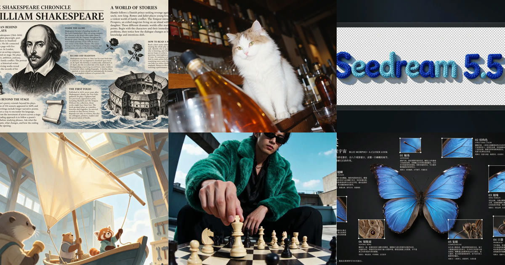

<div align="center">

<a href="https://apiko.app/zh-tw/seedream-5-5-prompts?utm_source=github&utm_medium=banner&utm_campaign=awesome-seedream-5.5-prompts"></a>

[](LICENSE)
[](README_zh-TW.md#menu)
[](https://apiko.app/zh-tw/models/seedream-5.5?utm_source=github&utm_medium=badge&utm_campaign=awesome-seedream-5.5-prompts&utm_content=model_try)
[](https://apiko.app/zh-tw/docs/api-manual/image-series/seedream-5.5/images?utm_source=github&utm_medium=badge&utm_campaign=awesome-seedream-5.5-prompts&utm_content=docs)

[](README.md)
[](README_zh-CN.md)
[](README_zh-TW.md)
[](README_ko.md)

</div>

# Awesome Seedream 5.5 提示詞

<a id="introduction"></a>
## 🌟 簡介

**Seedream 5.5 提示詞：51 則附效果圖的範例，來自字節跳動 Seed、BytePlus 和創作者實測，涵蓋攝影、海報文字、透明底素材和角色插畫。**

本頁每張效果圖都由 Seedream 5.5 生成。直接複製提示詞，或送到試用台改幾處細節再跑。

線上搜尋與篩選： [apiko.app/seedream-5-5-prompts](https://apiko.app/zh-tw/seedream-5-5-prompts?utm_source=github&utm_medium=readme&utm_campaign=awesome-seedream-5.5-prompts&utm_content=intro).

> [!NOTE]
> 提示詞保持作者發布時的原文，所以大多是英文；標題與簡介由我們撰寫。每則都署名作者並連結原帖。

<a id="quick-start"></a>
## 🚀 快速開始

**網頁上用：** 每則都有「在 APIKO 執行」連結，會在 [apiko.app](https://apiko.app/zh-tw/seedream-5-5-prompts?utm_source=github&utm_medium=quickstart&utm_campaign=awesome-seedream-5.5-prompts&utm_content=browser) 開啟這則範例；點「使用」，提示詞就會填進 Seedream 5.5 試用台。

**用 API：** 先建立 [APIKO API 金鑰](https://apiko.app/zh-tw/dashboard/apikeys?utm_source=github&utm_medium=quickstart&utm_campaign=awesome-seedream-5.5-prompts&utm_content=api_key)，再建立非同步任務並輪詢，直到圖片生成完成。

```bash
export APIKO_API_KEY="your_key_here"

TASK_ID=$(curl -s https://api.apiko.app/v1/images/generations \
  -H "Authorization: Bearer $APIKO_API_KEY" \
  -H "Content-Type: application/json" \
  -d '{
  "model": "seedream-5.5",
  "prompt": "A minimalist poster of a paper boat on a calm lake at sunrise, the title \"Morning\" in bold serif type.",
  "size": "16:9",
  "resolution": "1K",
  "async": true
}' | python3 -c 'import json,sys; print(json.load(sys.stdin)["id"])')

# When status is "completed", the image is at data[0].url (kept for 24 hours).
while :; do
  TASK=$(curl -s https://api.apiko.app/v1/tasks/$TASK_ID \
    -H "Authorization: Bearer $APIKO_API_KEY")
  printf '%s\n' "$TASK"
  printf '%s' "$TASK" | grep -qE '"status": *"(completed|failed)"|"error": *\{' && break
  sleep 5
done
```

介面: `POST https://api.apiko.app/v1/images/generations` (建立任務) · `GET https://api.apiko.app/v1/tasks/{id}` (查詢狀態與結果)

<a id="how-to-write"></a>
## ✍️ Seedream 5.5 提示詞怎麼寫

本頁提示詞裡反覆出現的四種寫法。

- **照相機的思路描述畫面** · `畫幅 + 機位 + 光源 + 底片或鏡頭 + 保留哪些不完美` — 寫實類提示詞會寫明畫幅（3:4 直幅、超廣角、傾斜 25°）、光源（閃光燈、窗光、鈉燈）以及想要的顆粒或曝光不足。
- **每個字都加引號** · `版式 + 「引號裡的原文」 + 層級 + 不要多餘文字` — 海報、標籤和資訊圖表把每行字放進引號並說明位置，最後禁止模型自己編字。
- **透明底：提示詞寫明，參數也要開** · `主體 + 透明背景 + 哪些部分半透明` — 素材類提示詞會說清哪裡全透明、哪裡半透明、哪裡不透明；同時把背景參數設為 transparent。
- **改圖只改一處，並列出不能動的** · `把 X 改成… + A、B、C 保持不變` — 編輯類提示詞先說改什麼，再列出保持不變的元素，Seedream 5.5 多輪編輯時沒改的像素才會維持原樣。

**從範例裡能看到什麼**

- **隨手拍只要一句話。** 「手機隨手拍，超真實，北京一個胡同，下雪了」這樣一句話，不寫任何相機參數，也拍出很像實拍的街景。
- **中文小字也能寫清楚。** 藍閃蝶資訊圖表、分鏡和九宮格貼圖裡有大量中文小字；印刷前仍要逐字核對。
- **多格圖能維持同一個角色。** 三視圖、六格分鏡和九宮格都要求每一格的臉、服裝和光線一致。
- **參考圖決定風格。** 毛線字和雪鴞微距從上傳的圖裡取質感和構圖；標註需要參考圖的卡片，請上傳你自己的圖。

<a id="menu"></a>
## 📑 目錄

- [• 攝影](#photography) (19)
  - [夜晚酒吧裡的白貓，閃光燈加 Provia 底片色](#photography-01)
  - [窗光下抱著嬰兒小睡的父親](#photography-02)
  - [南歐街角的檸檬黃牆與紫色木門](#photography-03)
  - [畫面傾斜 25 度的大風街頭隨拍](#photography-04)
  - [夏夜歐洲小酒館裡用餐的長者](#photography-05)
  - [雨後水窪裡的金色建築倒影](#photography-06)
  - [地鐵月台上動態模糊的通勤人潮](#photography-07)
  - [超廣角：從柵欄縫探頭的驢](#photography-08)
  - [從泳池裡提起拼成 seedream 的水珠](#photography-09)
  - [天台下棋超低機位，前景巨大的國王棋子](#photography-10)
  - [倫敦夜晚店面上的三種語言招牌](#photography-11)
  - [含淚眼睛的微距特寫與玻璃上的小字](#photography-12)
  - [藍調時刻補漁網的老漁夫](#photography-13)
  - [90 年代蘇聯老公車旁的冬日時裝照](#photography-14)
  - [地鐵手扶梯上回眸的電影感人像](#photography-15)
  - [手機隨手拍：下雪的北京胡同](#photography-16)
  - [手機隨手拍：五環外掃雪的清潔工](#photography-17)
  - [手機隨手拍：下雪的天津海河邊](#photography-18)
  - [冰塊裡的雛菊融化 60 分鐘六格圖](#photography-19)
- [• 文字、海報與設計](#text-design) (11)
  - [英文文學特刊《莎士比亞紀事報》](#text-design-01)
  - [街頭印刷主題的塗鴉拼貼海報](#text-design-02)
  - [資訊圖表海報〈從種子到沙拉〉](#text-design-03)
  - [中英雙語藍閃蝶科普資訊圖表](#text-design-04)
  - [滿是小字欄目的雜誌封面](#text-design-05)
  - [帶細小文字的精華液包裝樣機](#text-design-06)
  - [瑞士風格演出海報 Night Signal](#text-design-07)
  - [虛構深海鰻魚的博物圖鑑頁](#text-design-08)
  - [為錄影軟體設計 10 種風格圖示](#text-design-09)
  - [短劇封面《第13层》：昏暗走廊裡的電梯](#text-design-10)
  - [膨脹氣球立體字「夯爆了」](#text-design-11)
- [• 透明底素材與改圖](#transparent-assets) (12)
  - [奔跑女孩連續動作，每格一張透明圖層](#transparent-assets-01)
  - [透明底的兩套卡通貼紙](#transparent-assets-02)
  - [藍色毛線纏繞的 Seedream 5.5 字樣](#transparent-assets-03)
  - [四個毛絨角色，各自一張透明圖](#transparent-assets-04)
  - [改圖：吹出粉紅泡泡糖，其餘不變](#transparent-assets-05)
  - [帶播放器介面的聖誕壓克力立牌](#transparent-assets-06)
  - [從兩張圖裡擷取貼紙，合成一張透明圖](#transparent-assets-07)
  - [半透明的玻璃水母燈](#transparent-assets-08)
  - [琥珀色香水瓶透明素材](#transparent-assets-09)
  - [全身街頭穿搭去背素材](#transparent-assets-10)
  - [手持霧面壓克力板的半透明素材](#transparent-assets-11)
  - [用於疊加的鍍鉻緞帶標誌](#transparent-assets-12)
- [• 插畫與角色](#illustration-characters) (9)
  - [水粉繪本：雲海滑翔機工坊](#illustration-characters-01)
  - [藍莓收藏角色設定板 BERRY CLUB](#illustration-characters-02)
  - [撐彩虹傘的衍紙舞者](#illustration-characters-03)
  - [漢服女醫的三視圖設定稿](#illustration-characters-04)
  - [帶色卡的動漫人設卡](#illustration-characters-05)
  - [標註景別的六格分鏡](#illustration-characters-06)
  - [同一時刻的村落內外雙格圖](#illustration-characters-07)
  - [鯨魚尾少女的九宮格貼圖](#illustration-characters-08)
  - [毛氈質感的鯨魚尾少女公仔](#illustration-characters-09)
- [❓ 常見問題](#faq)
- [🔗 相關連結](#related)

<a id="photography"></a>
## • 攝影

> 街拍、紀實、人像和手機隨手拍，看光線、皮膚和材質。 · 19 則

<a id="photography-01"></a>
### 1. 夜晚酒吧裡的白貓，閃光燈加 Provia 底片色

作者 [@ByteDance Seed](https://seed.bytedance.com/en/seedream5_5) · 3:2 · **[▶ 在 APIKO 執行](https://apiko.app/zh-tw/seedream-5-5-prompts?utm_source=github&utm_medium=case&utm_campaign=awesome-seedream-5.5-prompts&utm_content=photography-01#photography-01)** · [原帖](https://seed.bytedance.com/en/seedream5_5)

<a href="https://apiko.app/zh-tw/seedream-5-5-prompts?utm_source=github&utm_medium=case&utm_campaign=awesome-seedream-5.5-prompts&utm_content=photography-01#photography-01"></a>

**提示詞:**

```text
A white cat sits elegantly among bottles and glasses in a bar at night. Shoot from a low angle with a tilted composition, using flash, Fujifilm Provia colors and film grain. Capture dappled light, bright highlights and crisp detail for a vintage photographic feel.
```

<a id="photography-02"></a>
### 2. 窗光下抱著嬰兒小睡的父親

作者 [@ByteDance Seed](https://seed.bytedance.com/en/seedream5_5) · 16:9 · **[▶ 在 APIKO 執行](https://apiko.app/zh-tw/seedream-5-5-prompts?utm_source=github&utm_medium=case&utm_campaign=awesome-seedream-5.5-prompts&utm_content=photography-02#photography-02)** · [原帖](https://seed.bytedance.com/en/seedream5_5)

<a href="https://apiko.app/zh-tw/seedream-5-5-prompts?utm_source=github&utm_medium=case&utm_campaign=awesome-seedream-5.5-prompts&utm_content=photography-02#photography-02"></a>

**提示詞:**

```text
A warm documentary photograph of a young father reclining on a dark purple-gray fabric sofa, holding a sleeping baby. Cream knitted cushions and a mustard-yellow blanket show soft, tactile fabric textures. Warm golden daylight enters through a window on the right. Relaxed poses, natural skin tones, gentle shadows and film grain capture a quiet, intimate afternoon.
```

<a id="photography-03"></a>
### 3. 南歐街角的檸檬黃牆與紫色木門

作者 [@ByteDance Seed](https://seed.bytedance.com/en/seedream5_5) · 3:4 · **[▶ 在 APIKO 執行](https://apiko.app/zh-tw/seedream-5-5-prompts?utm_source=github&utm_medium=case&utm_campaign=awesome-seedream-5.5-prompts&utm_content=photography-03#photography-03)** · [原帖](https://seed.bytedance.com/en/seedream5_5)

<a href="https://apiko.app/zh-tw/seedream-5-5-prompts?utm_source=github&utm_medium=case&utm_campaign=awesome-seedream-5.5-prompts&utm_content=photography-03#photography-03"></a>

**提示詞:**

```text
A vertical 3:4 street photograph of a southern European corner. A lemon-yellow limewashed wall, an old deep-purple wooden door and hanging royal-purple linen form a bold geometric composition. Golden flowers fill a weathered metal bucket at the lower right. Strong afternoon sunlight casts crisp shadows, revealing textured plaster, fabric folds, rust and layered petals in vivid complementary purple and yellow.
```

<a id="photography-04"></a>
### 4. 畫面傾斜 25 度的大風街頭隨拍

作者 [@ByteDance Seed](https://seed.bytedance.com/en/seedream5_5) · 16:9 · **[▶ 在 APIKO 執行](https://apiko.app/zh-tw/seedream-5-5-prompts?utm_source=github&utm_medium=case&utm_campaign=awesome-seedream-5.5-prompts&utm_content=photography-04#photography-04)** · [原帖](https://seed.bytedance.com/en/seedream5_5)

<a href="https://apiko.app/zh-tw/seedream-5-5-prompts?utm_source=github&utm_medium=case&utm_campaign=awesome-seedream-5.5-prompts&utm_content=photography-04#photography-04"></a>

**提示詞:**

```text
A candid horizontal street photograph of a long-haired woman in a burgundy top and light brown jacket looking down at her phone. Strong wind sweeps her hair across her sunglasses and face. The entire frame tilts about 25 degrees clockwise, with consistent perspective across the figure, buildings, lamppost and pavement. Natural clothing folds, hurried framing and asymmetric cropping create an unposed everyday moment.
```

<a id="photography-05"></a>
### 5. 夏夜歐洲小酒館裡用餐的長者

作者 [@ByteDance Seed](https://seed.bytedance.com/en/seedream5_5) · 16:9 · **[▶ 在 APIKO 執行](https://apiko.app/zh-tw/seedream-5-5-prompts?utm_source=github&utm_medium=case&utm_campaign=awesome-seedream-5.5-prompts&utm_content=photography-05#photography-05)** · [原帖](https://seed.bytedance.com/en/seedream5_5)

<a href="https://apiko.app/zh-tw/seedream-5-5-prompts?utm_source=github&utm_medium=case&utm_campaign=awesome-seedream-5.5-prompts&utm_content=photography-05#photography-05"></a>

**提示詞:**

```text
A candid horizontal snapshot inside a neighborhood bistro in Europe on a summer evening. Two older diners eat naturally at a table covered with cream linen, unaware of the camera. Glasses, cutlery, breadcrumbs and worn wooden furniture show everyday use. Warm pendant lights mix with traces of cool evening light. Slight underexposure, subtle high-ISO grain and foreground occlusion create an intimate, spontaneous atmosphere.
```

<a id="photography-06"></a>
### 6. 雨後水窪裡的金色建築倒影

作者 [@ByteDance Seed](https://seed.bytedance.com/en/seedream5_5) · 3:4 · **[▶ 在 APIKO 執行](https://apiko.app/zh-tw/seedream-5-5-prompts?utm_source=github&utm_medium=case&utm_campaign=awesome-seedream-5.5-prompts&utm_content=photography-06#photography-06)** · [原帖](https://seed.bytedance.com/en/seedream5_5)

<a href="https://apiko.app/zh-tw/seedream-5-5-prompts?utm_source=github&utm_medium=case&utm_campaign=awesome-seedream-5.5-prompts&utm_content=photography-06#photography-06"></a>

**提示詞:**

```text
A vertical 3:4 street photograph after rain, taken from a low angle looking down at wet paving stones and irregular puddles. Reflections of an old building’s golden carvings, window frames and colonnades are fragmented by exposed stones, puddle edges and ripples. Warm golden light contrasts with deep-blue reflections, preserving worn joints and wet surface textures. No full building, people or vehicles appear.
```

<a id="photography-07"></a>
### 7. 地鐵月台上動態模糊的通勤人潮

作者 [@ByteDance Seed](https://seed.bytedance.com/en/seedream5_5) · 3:2 · **[▶ 在 APIKO 執行](https://apiko.app/zh-tw/seedream-5-5-prompts?utm_source=github&utm_medium=case&utm_campaign=awesome-seedream-5.5-prompts&utm_content=photography-07#photography-07)** · [原帖](https://seed.bytedance.com/en/seedream5_5)

<a href="https://apiko.app/zh-tw/seedream-5-5-prompts?utm_source=github&utm_medium=case&utm_campaign=awesome-seedream-5.5-prompts&utm_content=photography-07#photography-07"></a>

**提示詞:**

```text
Photograph a busy modern city subway platform filled with Asian commuters walking briskly in orderly flows. Use central perspective, with the platform, yellow safety lines and overhead lights receding into the distance. Combine motion blur, soft diffuse light and a subtle glow while retaining highlight and shadow detail to convey the energy of urban life.
```

<a id="photography-08"></a>
### 8. 超廣角：從柵欄縫探頭的驢

作者 [@ByteDance Seed](https://seed.bytedance.com/en/seedream5_5) · 16:9 · **[▶ 在 APIKO 執行](https://apiko.app/zh-tw/seedream-5-5-prompts?utm_source=github&utm_medium=case&utm_campaign=awesome-seedream-5.5-prompts&utm_content=photography-08#photography-08)** · [原帖](https://seed.bytedance.com/en/seedream5_5)

<a href="https://apiko.app/zh-tw/seedream-5-5-prompts?utm_source=github&utm_medium=case&utm_campaign=awesome-seedream-5.5-prompts&utm_content=photography-08#photography-08"></a>

**提示詞:**

```text
A horizontal ultra-wide-angle photograph of a curious gray-brown donkey peering through a vertical gap in a weathered wooden fence. Its broad muzzle nearly touches the lens, while its eyes and long ears recede in exaggerated close-up perspective. Focus on the muzzle’s fine hair, whiskers and skin texture, with softly blurred fence boards, blue sky and grass beyond. Natural daylight creates a playful candid moment.
```

<a id="photography-09"></a>
### 9. 從泳池裡提起拼成 seedream 的水珠

作者 [@ByteDance Seed](https://seed.bytedance.com/en/seedream5_5) · 2:3 · **[▶ 在 APIKO 執行](https://apiko.app/zh-tw/seedream-5-5-prompts?utm_source=github&utm_medium=case&utm_campaign=awesome-seedream-5.5-prompts&utm_content=photography-09#photography-09)** · [原帖](https://seed.bytedance.com/en/seedream5_5)

<a href="https://apiko.app/zh-tw/seedream-5-5-prompts?utm_source=github&utm_medium=case&utm_campaign=awesome-seedream-5.5-prompts&utm_content=photography-09#photography-09"></a>

**提示詞:**

```text
A hand lifts a string of water droplets from a miniature swimming pool. The droplets spell “seedream” vertically. Surreal summer photography with vivid colors and a film-like texture.
```

<a id="photography-10"></a>
### 10. 天台下棋超低機位，前景巨大的國王棋子

作者 [@MayorKingAI](https://x.com/MayorKingAI) · 4:5 · **[▶ 在 APIKO 執行](https://apiko.app/zh-tw/seedream-5-5-prompts?utm_source=github&utm_medium=case&utm_campaign=awesome-seedream-5.5-prompts&utm_content=photography-10#photography-10)** · [原帖](https://x.com/MayorKingAI/status/2120198834508955990)

<a href="https://apiko.app/zh-tw/seedream-5-5-prompts?utm_source=github&utm_medium=case&utm_campaign=awesome-seedream-5.5-prompts&utm_content=photography-10#photography-10"></a>

**提示詞:**

```text
An ultra-realistic high-fashion editorial photograph of a striking 28-year-old Japanese man with sharp facial features, a defined jawline, slightly messy medium-length black hair and narrow rectangular black sunglasses, sitting confidently on a rooftop terrace while playing chess.

He wears an oversized luxurious emerald-green faux-fur coat over a black silk shirt, tailored black trousers and a subtle silver chain necklace. His expression is calm, confident and slightly intimidating, looking directly toward the camera.

Camera composition: An extreme low-angle shot taken from the very edge of a chessboard, with the camera positioned only a few centimeters above the board's surface. The black-and-white chessboard dominates the entire bottom third of the frame, its squares appearing exceptionally large in the foreground and rapidly shrinking toward the seated man.

The man is centered in the composition, visible from approximately the knees upward, leaning slightly forward. His right arm extends directly toward the camera, with his hand dramatically enlarged by perspective. He is gripping the top of a polished ivory wooden king chess piece between his thumb and index finger, moving it toward an empty square near the camera. The king is dramatically oversized in the immediate foreground due to the wide-angle perspective, while the remaining chess pieces appear progressively smaller toward the background.

His other hand rests naturally near his knee. The chess pieces are physically accurate and positioned naturally on the board, with realistic contact shadows and detailed polished wooden surfaces.

Environment: An open urban rooftop with subtle concrete architectural details, low surrounding rooftops and an enormous vivid cyan-blue sky with a few soft, scattered white clouds. The bright sky occupies the upper half of the composition, creating strong visual contrast against the emerald-green coat.

Photography: Shot on a Sony A1 II with a 20mm wide-angle lens, camera placed at chessboard level, f/8, ISO 100, 1/1000s. Deep environmental perspective, exaggerated foreground scale, realistic optical distortion, crisp textures across the chessboard and subject. Bright natural midday sunlight, accurate skin tones, natural facial asymmetry, individual hair strands, detailed fabric and fur fibers, subtle imperfections and physically realistic shadows.

Authentic luxury fashion campaign photography, bold editorial framing, natural photographic color grading, exceptionally realistic skin texture, no artificial skin smoothing, no CGI appearance, no illustration, no plastic textures, no excessive cinematic effects.
```

<a id="photography-11"></a>
### 11. 倫敦夜晚店面上的三種語言招牌

作者 [@Dheepanratnam](https://x.com/Dheepanratnam) · 16:9 · **[▶ 在 APIKO 執行](https://apiko.app/zh-tw/seedream-5-5-prompts?utm_source=github&utm_medium=case&utm_campaign=awesome-seedream-5.5-prompts&utm_content=photography-11#photography-11)** · [原帖](https://x.com/Dheepanratnam/status/2119767938173387065)

<a href="https://apiko.app/zh-tw/seedream-5-5-prompts?utm_source=github&utm_medium=case&utm_campaign=awesome-seedream-5.5-prompts&utm_content=photography-11#photography-11"></a>

**提示詞:**

```text
Photorealistic street scene in a multicultural London neighbourhood at night. A shopfront sign reads exactly “OPEN LATE” in English, with a smaller hanging sign reading exactly “欢迎光临” in simplified Chinese and another small poster reading exactly “Bienvenue” in French. Realistic neon glow, legible typography, correct character shapes, no duplicated letters, no warped glyphs, natural perspective on the signs, cinematic night photography, wet pavement reflections, no extra invented text.
```

<a id="photography-12"></a>
### 12. 含淚眼睛的微距特寫與玻璃上的小字

作者 [@Yuziyyaa](https://x.com/Yuziyyaa) · 1:1 · **[▶ 在 APIKO 執行](https://apiko.app/zh-tw/seedream-5-5-prompts?utm_source=github&utm_medium=case&utm_campaign=awesome-seedream-5.5-prompts&utm_content=photography-12#photography-12)** · [原帖](https://x.com/Yuziyyaa/status/2119799602580955179)

<a href="https://apiko.app/zh-tw/seedream-5-5-prompts?utm_source=github&utm_medium=case&utm_campaign=awesome-seedream-5.5-prompts&utm_content=photography-12#photography-12"></a>

**提示詞:**

```text
电影感极致特写，年轻女性的一只眼睛占据画面中心，下眼睑挂着一颗即将落下的泪珠，泪珠有真实折射、内部高光和边缘表面张力。虹膜呈深棕色纤维纹理，瞳孔因光线略微放大，睫毛湿润粘连且根根可辨。几缕深色湿润发丝从上方垂落横过眼睛，发丝边缘被逆光打透呈金边，每根有独立厚度与细微毛躁。皮肤可见毛孔、绒毛与自然油光差异。画面右下角有一小片透明玻璃片，玻璃上印有清晰小字“Seedream 5.5”和中文“百轮测试”，字体无崩坏。光线为戏剧性侧光+冷暖对比（面部偏暖，阴影偏冷蓝），泪珠与玻璃同时反射高光。85mm微距，浅景深，背景深蓝黑色调，超写实摄影，皮肤与液体有真实物理质感，无CG感。
```

<a id="photography-13"></a>
### 13. 藍調時刻補漁網的老漁夫

作者 [@ahmetmertugrul](https://x.com/ahmetmertugrul) · 16:9 · **[▶ 在 APIKO 執行](https://apiko.app/zh-tw/seedream-5-5-prompts?utm_source=github&utm_medium=case&utm_campaign=awesome-seedream-5.5-prompts&utm_content=photography-13#photography-13)** · [原帖](https://x.com/ahmetmertugrul/status/2119922071916757233)

<a href="https://apiko.app/zh-tw/seedream-5-5-prompts?utm_source=github&utm_medium=case&utm_campaign=awesome-seedream-5.5-prompts&utm_content=photography-13#photography-13"></a>

**提示詞:**

```text
Candid documentary photo, 85mm lens, f/2. An elderly fisherman in his seventies mending a tangled orange net on a wooden dock at blue hour. Mixed lighting: cold blue ambient sky from the left, a single warm sodium-vapor streetlamp from behind creating a rim light on his white stubble and the loose net fibers. Visible pores, deep wrinkles, sun spots, slightly chapped lips, a small healed scar on his knuckle. Wet wooden planks with puddles reflecting the lamp. Light drizzle visible only in the backlight. No beauty retouching, natural film grain, slight underexposure in the shadows.
```

<a id="photography-14"></a>
### 14. 90 年代蘇聯老公車旁的冬日時裝照

作者 [@ZaraIrahh](https://x.com/ZaraIrahh) · 2:3 · **[▶ 在 APIKO 執行](https://apiko.app/zh-tw/seedream-5-5-prompts?utm_source=github&utm_medium=case&utm_campaign=awesome-seedream-5.5-prompts&utm_content=photography-14#photography-14)** · [原帖](https://x.com/ZaraIrahh/status/2120161811571912709)

<a href="https://apiko.app/zh-tw/seedream-5-5-prompts?utm_source=github&utm_medium=case&utm_campaign=awesome-seedream-5.5-prompts&utm_content=photography-14#photography-14"></a>

**提示詞:**

```text
Photorealistic fashion editorial with the atmosphere of a winter morning in the early 1990s, in a Soviet-era residential neighborhood. A beautiful adult brunette woman with delicate facial features stands beside the open folding doors of an aged cream-and-red Soviet LiAZ-677 city bus. She holds a small bouquet of dried wildflowers wrapped in vintage brown kraft paper, gently gripping it with both hands in front of her thighs.

She wears an oversized charcoal wool coat, a soft ivory knitted scarf, a dark burgundy ribbed sweater, straight dark trousers and black leather winter boots. Loose dark brown hair falls naturally around her face, a few strands lifted by the freezing wind. Flushed cheeks, minimal makeup, thoughtful expression, looking slightly past the camera, shoulders gently raised against the cold.

Snow-covered pavement, compacted gray snow beside the bus wheels, frosted windows with condensation, faded red paint, weathered metal. Blurred Soviet apartment blocks and a modest bus shelter in the distance. Fine snowflakes in the air, visible breath. The delicate dried flowers add a subtle warm color accent against the muted winter surroundings.

Three-quarter portrait framed from the knees up, eye-level camera, woman placed off-center, the bus filling one side of the composition. Cold overcast daylight with direct on-camera flash, crisp face, deep background, subtle analog film grain, restrained colors, candid 1990s street photography combined with luxury fashion editorial. Real skin texture, tactile wool, believable hands and bouquet construction, shot on a 50mm lens --ar 3:4 --style raw --s 150 --no modern cars smartphones logos text watermark
```

<a id="photography-15"></a>
### 15. 地鐵手扶梯上回眸的電影感人像

作者 [@johnAGI168](https://x.com/johnAGI168) · 3:4 · **[▶ 在 APIKO 執行](https://apiko.app/zh-tw/seedream-5-5-prompts?utm_source=github&utm_medium=case&utm_campaign=awesome-seedream-5.5-prompts&utm_content=photography-15#photography-15)** · [原帖](https://x.com/johnAGI168/status/2120363733713039575)

<a href="https://apiko.app/zh-tw/seedream-5-5-prompts?utm_source=github&utm_medium=case&utm_campaign=awesome-seedream-5.5-prompts&utm_content=photography-15#photography-15"></a>

**提示詞:**

```text
A cinematic vertical 35mm photograph captured at eye level — an evocative over-the-shoulder medium portrait of a stunning young East Asian woman looking back toward the camera while riding a dimly lit subway escalator.

She possesses delicate, melancholic beauty with expressive dark eyes and natural lips, casting an enigmatic glance over her shoulder. Her long, layered jet-black hair blows freely in the underground draft, with loose strands sweeping across her cheeks and face with realistic kinetic motion. She wears a minimalist black spaghetti-strap slip top that reveals elegant collarbones and bare shoulders.

The setting is a vintage metro tunnel with escalator railings receding into deep perspective. Overhead linear fluorescent lights glow with a soft amber-green halation bloom, while the distant terminal melts into colorful circular bokeh of red, cyan, and warm white, creating a moody, nostalgic urban atmosphere reminiscent of 90s cinema.

Shot on a fast 50mm vintage prime at f/1.4 with soft diffusion filtration and authentic 35mm film grain in an M1 cinematic narrative register. Genuine human skin with fine pores, biological warmth, realistic wind dynamics on hair, and rich color-negative film roll-off — cinematic frame, strictly no CGI, no 3D render, no plastic skin, no artificial smoothing.
```

<a id="photography-16"></a>
### 16. 手機隨手拍：下雪的北京胡同

作者 [@vista8](https://x.com/vista8) · 3:2 · **[▶ 在 APIKO 執行](https://apiko.app/zh-tw/seedream-5-5-prompts?utm_source=github&utm_medium=case&utm_campaign=awesome-seedream-5.5-prompts&utm_content=photography-16#photography-16)** · [原帖](https://x.com/vista8/status/2120085580264714732)

<a href="https://apiko.app/zh-tw/seedream-5-5-prompts?utm_source=github&utm_medium=case&utm_campaign=awesome-seedream-5.5-prompts&utm_content=photography-16#photography-16"></a>

**提示詞:**

```text
手机随手拍，超真实，北京一个胡同，下雪了
```

<a id="photography-17"></a>
### 17. 手機隨手拍：五環外掃雪的清潔工

作者 [@vista8](https://x.com/vista8) · 3:2 · **[▶ 在 APIKO 執行](https://apiko.app/zh-tw/seedream-5-5-prompts?utm_source=github&utm_medium=case&utm_campaign=awesome-seedream-5.5-prompts&utm_content=photography-17#photography-17)** · [原帖](https://x.com/vista8/status/2120085580264714732)

<a href="https://apiko.app/zh-tw/seedream-5-5-prompts?utm_source=github&utm_medium=case&utm_campaign=awesome-seedream-5.5-prompts&utm_content=photography-17#photography-17"></a>

**提示詞:**

```text
手机随手拍，北京五环外，环卫工人在扫雪，超真实
```

<a id="photography-18"></a>
### 18. 手機隨手拍：下雪的天津海河邊

作者 [@vista8](https://x.com/vista8) · 3:2 · **[▶ 在 APIKO 執行](https://apiko.app/zh-tw/seedream-5-5-prompts?utm_source=github&utm_medium=case&utm_campaign=awesome-seedream-5.5-prompts&utm_content=photography-18#photography-18)** · [原帖](https://x.com/vista8/status/2120085580264714732)

<a href="https://apiko.app/zh-tw/seedream-5-5-prompts?utm_source=github&utm_medium=case&utm_campaign=awesome-seedream-5.5-prompts&utm_content=photography-18#photography-18"></a>

**提示詞:**

```text
手机随手拍，超真实，天津海河边，下雪了
```

<a id="photography-19"></a>
### 19. 冰塊裡的雛菊融化 60 分鐘六格圖

作者 [@oran_ge](https://x.com/oran_ge) · 1:1 · **[▶ 在 APIKO 執行](https://apiko.app/zh-tw/seedream-5-5-prompts?utm_source=github&utm_medium=case&utm_campaign=awesome-seedream-5.5-prompts&utm_content=photography-19#photography-19)** · [原帖](https://x.com/oran_ge/status/2120037929615503812)

<a href="https://apiko.app/zh-tw/seedream-5-5-prompts?utm_source=github&utm_medium=case&utm_campaign=awesome-seedream-5.5-prompts&utm_content=photography-19#photography-19"></a>

**提示詞:**

```text
2×3 六格，同一机位。一块方冰里冻着一朵小雏菊，放在白瓷盘上，背景深灰蓝。六格依次是 0、5、10、20、40、60 分钟：冰从完整方块，到边缘化开、体积变薄，最后只剩一摊水，雏菊一直在原来的位置。每格底部标分钟数。冷调柔光，冰要通透，能看见花被冻在里面的折射。
```

<a id="text-design"></a>
## • 文字、海報與設計

> 報紙、資訊圖表、封面、包裝標籤和圖示，字要一個不錯。 · 11 則

<a id="text-design-01"></a>
### 20. 英文文學特刊《莎士比亞紀事報》

作者 [@ByteDance Seed](https://seed.bytedance.com/en/seedream5_5) · 3:2 · **[▶ 在 APIKO 執行](https://apiko.app/zh-tw/seedream-5-5-prompts?utm_source=github&utm_medium=case&utm_campaign=awesome-seedream-5.5-prompts&utm_content=text-design-01#text-design-01)** · [原帖](https://seed.bytedance.com/en/seedream5_5)

<a href="https://apiko.app/zh-tw/seedream-5-5-prompts?utm_source=github&utm_medium=case&utm_campaign=awesome-seedream-5.5-prompts&utm_content=text-design-01#text-design-01"></a>

**提示詞:**

```text
Design a landscape literary newspaper with the masthead “THE SHAKESPEARE CHRONICLE” and the headline “WILLIAM SHAKESPEARE”. On warm ivory paper, illustrate Shakespeare and the Globe Theatre in black engraving, with muted blue clouds and waves weaving through the page. Arrange seven short articles in English around the illustrations, using bold serif headings and legible small type.
```

<a id="text-design-02"></a>
### 21. 街頭印刷主題的塗鴉拼貼海報

作者 [@ByteDance Seed](https://seed.bytedance.com/en/seedream5_5) · 3:4 · **[▶ 在 APIKO 執行](https://apiko.app/zh-tw/seedream-5-5-prompts?utm_source=github&utm_medium=case&utm_campaign=awesome-seedream-5.5-prompts&utm_content=text-design-02#text-design-02)** · [原帖](https://seed.bytedance.com/en/seedream5_5)

<a href="https://apiko.app/zh-tw/seedream-5-5-prompts?utm_source=github&utm_medium=case&utm_campaign=awesome-seedream-5.5-prompts&utm_content=text-design-02#text-design-02"></a>

**提示詞:**

```text
Create a graffiti collage poster about collaborative street printing, using lime green, aubergine purple and mint over a gray-white photocopied paper texture. Oversized “PRINT PLAY!” lettering overlaps diagonally. A grayscale printmaker at the upper right holds a roller and print sample, with printing tools and handwritten phrases including “MAKE A MARK” and “PASS IT ON” below. Preserve matte halftone ink, fine grain and legible lettering in a layered, asymmetric composition.
```

<a id="text-design-03"></a>
### 22. 資訊圖表海報〈從種子到沙拉〉

作者 [@ByteDance Seed](https://seed.bytedance.com/en/seedream5_5) · 3:4 · **[▶ 在 APIKO 執行](https://apiko.app/zh-tw/seedream-5-5-prompts?utm_source=github&utm_medium=case&utm_campaign=awesome-seedream-5.5-prompts&utm_content=text-design-03#text-design-03)** · [原帖](https://seed.bytedance.com/en/seedream5_5)

<a href="https://apiko.app/zh-tw/seedream-5-5-prompts?utm_source=github&utm_medium=case&utm_campaign=awesome-seedream-5.5-prompts&utm_content=text-design-03#text-design-03"></a>

**提示詞:**

```text
Create an illustrated infographic poster titled “FROM SEED TO SALAD” on warm-white paper with a handmade print texture. One continuous path snakes across three tiers, linking six numbered stages in order: SOW, SPROUT, GROW, TEND, HARVEST and SHARE. Five correctly directed arrows connect the sequence. Pair miniature gardening scenes and English descriptions with each stage, keeping the reading order clear, lettering legible and colors soft yet varied.
```

<a id="text-design-04"></a>
### 23. 中英雙語藍閃蝶科普資訊圖表

作者 [@ByteDance Seed](https://seed.bytedance.com/en/seedream5_5) · 16:9 · **[▶ 在 APIKO 執行](https://apiko.app/zh-tw/seedream-5-5-prompts?utm_source=github&utm_medium=case&utm_campaign=awesome-seedream-5.5-prompts&utm_content=text-design-04#text-design-04)** · [原帖](https://seed.bytedance.com/en/seedream5_5)

<a href="https://apiko.app/zh-tw/seedream-5-5-prompts?utm_source=github&utm_medium=case&utm_campaign=awesome-seedream-5.5-prompts&utm_content=text-design-04#text-design-04"></a>

**提示詞:**

```text
A horizontal natural-history infographic titled “蓝闪蝶：一只蝴蝶的微观宇宙”, with the English heading “BLUE MORPHO・A CLOSER LOOK”. A large blue morpho spreads its wings against a black background, surrounded by eight macro-detail modules: antennae, structural color, wing margin, proboscis, compound eye, ventral wing, wing venation and wing scales. Pair Chinese explanations with English terms and observation notes. Preserve legible small text and fine wing textures, with a footer stating that enlarged details are illustrative and not to scale.
```

<a id="text-design-05"></a>
### 24. 滿是小字欄目的雜誌封面

作者 [@Dheepanratnam](https://x.com/Dheepanratnam) · 16:9 · **[▶ 在 APIKO 執行](https://apiko.app/zh-tw/seedream-5-5-prompts?utm_source=github&utm_medium=case&utm_campaign=awesome-seedream-5.5-prompts&utm_content=text-design-05#text-design-05)** · [原帖](https://x.com/Dheepanratnam/status/2119767938173387065)

<a href="https://apiko.app/zh-tw/seedream-5-5-prompts?utm_source=github&utm_medium=case&utm_campaign=awesome-seedream-5.5-prompts&utm_content=text-design-05#text-design-05"></a>

**提示詞:**

```text
Premium magazine cover design titled “THE FUTURE OF CREATIVE TOOLS”, with a realistic portrait of a stylish creative director in the lower third. Dense small cover lines around the edges: “Issue 24”, “AI Workflows”, “Design Systems”, “Cinematic Image Making”, “Inside the Studio”, “November 2026”. Clean modern serif masthead, precise kerning, crisp letterforms, editorial grid, muted cream background, subtle paper texture, high-end print-design layout. All text must be spelled exactly as written, no distorted letters, no duplicated words, no gibberish.
```

<a id="text-design-06"></a>
### 25. 帶細小文字的精華液包裝樣機

作者 [@Dheepanratnam](https://x.com/Dheepanratnam) · 16:9 · **[▶ 在 APIKO 執行](https://apiko.app/zh-tw/seedream-5-5-prompts?utm_source=github&utm_medium=case&utm_campaign=awesome-seedream-5.5-prompts&utm_content=text-design-06#text-design-06)** · [原帖](https://x.com/Dheepanratnam/status/2119767938173387065)

<a href="https://apiko.app/zh-tw/seedream-5-5-prompts?utm_source=github&utm_medium=case&utm_campaign=awesome-seedream-5.5-prompts&utm_content=text-design-06#text-design-06"></a>

**提示詞:**

```text
Minimalist skincare packaging mock-up on a pale stone pedestal. A frosted-glass serum bottle has a clean label reading exactly “LUMEN — BARRIER REPAIR SERUM”, with smaller text beneath: “30 ml / 1.0 fl oz”. Elegant sans-serif typography, perfectly straight label alignment, crisp small print, realistic glass refraction, soft studio lighting, subtle shadow, premium cosmetic advertising photography, no misspelled words, no extra branding, no watermark.
```

<a id="text-design-07"></a>
### 26. 瑞士風格演出海報 Night Signal

作者 [@Dheepanratnam](https://x.com/Dheepanratnam) · 16:9 · **[▶ 在 APIKO 執行](https://apiko.app/zh-tw/seedream-5-5-prompts?utm_source=github&utm_medium=case&utm_campaign=awesome-seedream-5.5-prompts&utm_content=text-design-07#text-design-07)** · [原帖](https://x.com/Dheepanratnam/status/2119767938173387065)

<a href="https://apiko.app/zh-tw/seedream-5-5-prompts?utm_source=github&utm_medium=case&utm_campaign=awesome-seedream-5.5-prompts&utm_content=text-design-07#text-design-07"></a>

**提示詞:**

```text
Bold gig poster for an underground electronic music night. Large headline reads exactly “NIGHT SIGNAL”, with supporting text: “Friday 27 November”, “Warehouse 9, London”, “Doors 10PM”. Experimental Swiss-style layout, high-contrast black, off-white and electric blue, grainy risograph texture, sharp geometric typography, intentional negative space, screen-print aesthetic. All words spelled exactly as specified, no extra text, no warped letters, no AI artefacts.
```

<a id="text-design-08"></a>
### 27. 虛構深海鰻魚的博物圖鑑頁

作者 [@ahmetmertugrul](https://x.com/ahmetmertugrul) · 16:9 · **[▶ 在 APIKO 執行](https://apiko.app/zh-tw/seedream-5-5-prompts?utm_source=github&utm_medium=case&utm_campaign=awesome-seedream-5.5-prompts&utm_content=text-design-08#text-design-08)** · [原帖](https://x.com/ahmetmertugrul/status/2119915956365369596)

<a href="https://apiko.app/zh-tw/seedream-5-5-prompts?utm_source=github&utm_medium=case&utm_campaign=awesome-seedream-5.5-prompts&utm_content=text-design-08#text-design-08"></a>

**提示詞:**

```text
A vintage naturalist field-guide page, aged cream paper with foxing stains, documenting a fictional deep-sea creature called "Lanternfin Abyssal Eel". Center: a detailed scientific ink-and-watercolor illustration of the eel with bioluminescent spots. Surrounding it, 10 numbered callout labels with thin leader lines, each with a 2-line caption in small serif type (e.g. "3. Photophore cluster — emits pulses at 490 nm to lure prey"). Top header in ornate engraved capitals: "PLATE XLVII — CREATURES OF THE MIDNIGHT ZONE". Bottom: a small data table with columns "Depth", "Length", "Lifespan", "Diet" and three rows of values, plus a tiny scale bar reading "10 cm". Flat top-down scan, every word sharp and legible.
```

<a id="text-design-09"></a>
### 28. 為錄影軟體設計 10 種風格圖示

作者 [@vista8](https://x.com/vista8) · 16:9 · **[▶ 在 APIKO 執行](https://apiko.app/zh-tw/seedream-5-5-prompts?utm_source=github&utm_medium=case&utm_campaign=awesome-seedream-5.5-prompts&utm_content=text-design-09#text-design-09)** · [原帖](https://x.com/vista8/status/2120085580264714732)

<a href="https://apiko.app/zh-tw/seedream-5-5-prompts?utm_source=github&utm_medium=case&utm_campaign=awesome-seedream-5.5-prompts&utm_content=text-design-09#text-design-09"></a>

**提示詞:**

```text
为一款名叫 Capwise 的录屏软件设计 10 种不同风格的 icon，扁平风格，顶级水平
```

<a id="text-design-10"></a>
### 29. 短劇封面《第13层》：昏暗走廊裡的電梯

作者 [@oran_ge](https://x.com/oran_ge) · 9:16 · **[▶ 在 APIKO 執行](https://apiko.app/zh-tw/seedream-5-5-prompts?utm_source=github&utm_medium=case&utm_campaign=awesome-seedream-5.5-prompts&utm_content=text-design-10#text-design-10)** · [原帖](https://x.com/oran_ge/status/2120037929615503812)

<a href="https://apiko.app/zh-tw/seedream-5-5-prompts?utm_source=github&utm_medium=case&utm_campaign=awesome-seedream-5.5-prompts&utm_content=text-design-10#text-design-10"></a>

**提示詞:**

```text
9:16 竖屏短剧封面。昏暗老楼走廊，尽头一扇半开的电梯门，门上红色 LED 楼层数字「13」是最亮的东西。三行字：顶部标题「第13层」，中部副题「短剧 · 全集上线」，底部一行「别按那个键」。红色数字要跳、字要清楚，三行字居中对称，不许压到人脸。冷绿灰调，走廊纵深要能看出景深，只有电梯里透出一点红光。
```

<a id="text-design-11"></a>
### 30. 膨脹氣球立體字「夯爆了」

作者 [@oran_ge](https://x.com/oran_ge) · 3:4 · **[▶ 在 APIKO 執行](https://apiko.app/zh-tw/seedream-5-5-prompts?utm_source=github&utm_medium=case&utm_campaign=awesome-seedream-5.5-prompts&utm_content=text-design-11#text-design-11)** · [原帖](https://x.com/oran_ge/status/2120037929615503812)

<a href="https://apiko.app/zh-tw/seedream-5-5-prompts?utm_source=github&utm_medium=case&utm_campaign=awesome-seedream-5.5-prompts&utm_content=text-design-11#text-design-11"></a>

**提示詞:**

```text
三个膨胀立体大字「夯爆了」，糖果色塑料气球质感，字要撑满画面，字与字之间互相挤压、有前后遮挡，边缘高光通透。浅粉橘色背景，几颗小星星和一团小烟做点缀。字体卡通、笔画圆胖。
```

<a id="transparent-assets"></a>
## • 透明底素材與改圖

> 原生 RGBA 輸出：貼紙、商品去背、半透明玻璃，以及只改一處、其餘不動的編輯。 · 12 則

<a id="transparent-assets-01"></a>
### 31. 奔跑女孩連續動作，每格一張透明圖層

作者 [@ByteDance Seed](https://seed.bytedance.com/en/seedream5_5) · 2:3 · **[▶ 在 APIKO 執行](https://apiko.app/zh-tw/seedream-5-5-prompts?utm_source=github&utm_medium=case&utm_campaign=awesome-seedream-5.5-prompts&utm_content=transparent-assets-01#transparent-assets-01)** · [原帖](https://seed.bytedance.com/en/seedream5_5)

<a href="https://apiko.app/zh-tw/seedream-5-5-prompts?utm_source=github&utm_medium=case&utm_campaign=awesome-seedream-5.5-prompts&utm_content=transparent-assets-01#transparent-assets-01"></a>

**提示詞:**

```text
Generate a sequence of images showing a girl running to the right, each on a separate layer with a transparent background.
```

<a id="transparent-assets-02"></a>
### 32. 透明底的兩套卡通貼紙

作者 [@ByteDance Seed](https://seed.bytedance.com/en/seedream5_5) · 9:16 · **[▶ 在 APIKO 執行](https://apiko.app/zh-tw/seedream-5-5-prompts?utm_source=github&utm_medium=case&utm_campaign=awesome-seedream-5.5-prompts&utm_content=transparent-assets-02#transparent-assets-02)** · [原帖](https://seed.bytedance.com/en/seedream5_5)

<a href="https://apiko.app/zh-tw/seedream-5-5-prompts?utm_source=github&utm_medium=case&utm_campaign=awesome-seedream-5.5-prompts&utm_content=transparent-assets-02#transparent-assets-02"></a>

**提示詞:**

```text
Generate two sets of cartoon stickers: one featuring ocean elements and cartoon cats, and the other featuring animals and plants. Keep the background transparent outside the sticker elements in both sets.
```

<a id="transparent-assets-03"></a>
### 33. 藍色毛線纏繞的 Seedream 5.5 字樣

作者 [@ByteDance Seed](https://seed.bytedance.com/en/seedream5_5) · 16:9 · **[▶ 在 APIKO 執行](https://apiko.app/zh-tw/seedream-5-5-prompts?utm_source=github&utm_medium=case&utm_campaign=awesome-seedream-5.5-prompts&utm_content=transparent-assets-03#transparent-assets-03)** · [原帖](https://seed.bytedance.com/en/seedream5_5)

<a href="https://apiko.app/zh-tw/seedream-5-5-prompts?utm_source=github&utm_medium=case&utm_campaign=awesome-seedream-5.5-prompts&utm_content=transparent-assets-03#transparent-assets-03"></a>

> 📎 這則需要你自己上傳參考圖。

**提示詞:**

```text
Create “Seedream 5.5” inspired by the reference texture and style. Use rounded, bold sans-serif letters wrapped in alternating royal-blue and lake-blue yarn, with visible fibers, fuzz and side shadows. Use a 16:9 landscape format with a transparent background outside the lettering.
```

<a id="transparent-assets-04"></a>
### 34. 四個毛絨角色，各自一張透明圖

作者 [@ByteDance Seed](https://seed.bytedance.com/en/seedream5_5) · 16:9 · **[▶ 在 APIKO 執行](https://apiko.app/zh-tw/seedream-5-5-prompts?utm_source=github&utm_medium=case&utm_campaign=awesome-seedream-5.5-prompts&utm_content=transparent-assets-04#transparent-assets-04)** · [原帖](https://seed.bytedance.com/en/seedream5_5)

<a href="https://apiko.app/zh-tw/seedream-5-5-prompts?utm_source=github&utm_medium=case&utm_campaign=awesome-seedream-5.5-prompts&utm_content=transparent-assets-04#transparent-assets-04"></a>

**提示詞:**

```text
Create a playful blue plush 3D cartoon character with a rounded body, big eyes and short limbs. Add three characters in the same style with distinct shapes and expressions. Output each character as a separate image with a transparent background, so the four characters can be separated and combined like puzzle pieces.
```

<a id="transparent-assets-05"></a>
### 35. 改圖：吹出粉紅泡泡糖，其餘不變

作者 [@BytePlus ModelArk](https://docs.byteplus.com/en/docs/ModelArk/seedream-5-5) · 3:4 · **[▶ 在 APIKO 執行](https://apiko.app/zh-tw/seedream-5-5-prompts?utm_source=github&utm_medium=case&utm_campaign=awesome-seedream-5.5-prompts&utm_content=transparent-assets-05#transparent-assets-05)** · [原帖](https://docs.byteplus.com/en/docs/ModelArk/seedream-5-5#multi-turn-editing-consistency)

<table>
<tr><td align="center"><a href="https://apiko.app/zh-tw/seedream-5-5-prompts?utm_source=github&utm_medium=case&utm_campaign=awesome-seedream-5.5-prompts&utm_content=transparent-assets-05#transparent-assets-05"></a></td><td align="center"><a href="https://apiko.app/zh-tw/seedream-5-5-prompts?utm_source=github&utm_medium=case&utm_campaign=awesome-seedream-5.5-prompts&utm_content=transparent-assets-05#transparent-assets-05"></a></td></tr>
</table>

> 📎 這則需要你自己上傳參考圖。

**提示詞:**

```text
Have the person blow a round, semi-transparent pink bubblegum bubble. Preserve the identity, facial features, gaze, hairstyle, pearl earrings, clothing, pose, blue background, composition, and visual style of the person.
```

<a id="transparent-assets-06"></a>
### 36. 帶播放器介面的聖誕壓克力立牌

作者 [@BytePlus ModelArk](https://docs.byteplus.com/en/docs/ModelArk/seedream-5-5) · 2:3 · **[▶ 在 APIKO 執行](https://apiko.app/zh-tw/seedream-5-5-prompts?utm_source=github&utm_medium=case&utm_campaign=awesome-seedream-5.5-prompts&utm_content=transparent-assets-06#transparent-assets-06)** · [原帖](https://docs.byteplus.com/en/docs/ModelArk/seedream-5-5#transparent-background)

<a href="https://apiko.app/zh-tw/seedream-5-5-prompts?utm_source=github&utm_medium=case&utm_campaign=awesome-seedream-5.5-prompts&utm_content=transparent-assets-06#transparent-assets-06"></a>

**提示詞:**

```text
A transparent acrylic standee with a Christmas theme, a rectangular outline, and a thin white edge on all sides that brings out the transparent material. Use a scrapbook collage style: place a red-and-green two-tone vinyl record with a golden rim at the center, surrounded by a dimensional Christmas wreath of acorn leaves and pine branches. Decorate the wreath with hand-drawn red berries, golden four-pointed stars, reindeer, and snowflake stickers. Overlay a minimalist white music-player UI below, with play/pause controls, a progress bar (01:24 / 04:32), and a volume icon. Use vintage red, forest green, champagne gold, and off-white. Add occasional highlights refracted by the acrylic thickness for a realistic product finish. Set a transparent background.
```

<a id="transparent-assets-07"></a>
### 37. 從兩張圖裡擷取貼紙，合成一張透明圖

作者 [@BytePlus ModelArk](https://docs.byteplus.com/en/docs/ModelArk/seedream-5-5) · 3:2 · **[▶ 在 APIKO 執行](https://apiko.app/zh-tw/seedream-5-5-prompts?utm_source=github&utm_medium=case&utm_campaign=awesome-seedream-5.5-prompts&utm_content=transparent-assets-07#transparent-assets-07)** · [原帖](https://docs.byteplus.com/en/docs/ModelArk/seedream-5-5#transparent-background)

<table>
<tr><td align="center"><a href="https://apiko.app/zh-tw/seedream-5-5-prompts?utm_source=github&utm_medium=case&utm_campaign=awesome-seedream-5.5-prompts&utm_content=transparent-assets-07#transparent-assets-07"></a></td><td align="center"><a href="https://apiko.app/zh-tw/seedream-5-5-prompts?utm_source=github&utm_medium=case&utm_campaign=awesome-seedream-5.5-prompts&utm_content=transparent-assets-07#transparent-assets-07"></a></td><td align="center"><a href="https://apiko.app/zh-tw/seedream-5-5-prompts?utm_source=github&utm_medium=case&utm_campaign=awesome-seedream-5.5-prompts&utm_content=transparent-assets-07#transparent-assets-07"></a></td></tr>
</table>

> 📎 這則需要你自己上傳參考圖。

**提示詞:**

```text
Extract the sticker elements from Image 1 and Image 2 separately, then place all extracted stickers in one transparent-background image. Preserve each sticker's original text, colors, shapes, and details; remove all background content other than the stickers. Arrange the stickers separately without overlap, with sharp and intact edges.
```

<a id="transparent-assets-08"></a>
### 38. 半透明的玻璃水母燈

作者 [@ahmetmertugrul](https://x.com/ahmetmertugrul) · 16:9 · **[▶ 在 APIKO 執行](https://apiko.app/zh-tw/seedream-5-5-prompts?utm_source=github&utm_medium=case&utm_campaign=awesome-seedream-5.5-prompts&utm_content=transparent-assets-08#transparent-assets-08)** · [原帖](https://x.com/ahmetmertugrul/status/2119920477535719739)

<a href="https://apiko.app/zh-tw/seedream-5-5-prompts?utm_source=github&utm_medium=case&utm_campaign=awesome-seedream-5.5-prompts&utm_content=transparent-assets-08#transparent-assets-08"></a>

**提示詞:**

```text
Transparent background, PNG with alpha channel. A hand-blown glass jellyfish lamp floating in mid-air: semi-transparent frosted bell with visible internal air bubbles, long trailing tentacles made of thin glass threads that fade from fully opaque at the top to almost invisible at the tips, a faint warm amber glow inside the bell, soft caustic refractions, wisps of translucent steam drifting from the tentacle ends. No background, no ground shadow, clean anti-aliased edges, studio product lighting.
```

<a id="transparent-assets-09"></a>
### 39. 琥珀色香水瓶透明素材

作者 [@Dheepanratnam](https://x.com/Dheepanratnam) · 1:1 · **[▶ 在 APIKO 執行](https://apiko.app/zh-tw/seedream-5-5-prompts?utm_source=github&utm_medium=case&utm_campaign=awesome-seedream-5.5-prompts&utm_content=transparent-assets-09#transparent-assets-09)** · [原帖](https://x.com/Dheepanratnam/status/2119775195573481859)

<a href="https://apiko.app/zh-tw/seedream-5-5-prompts?utm_source=github&utm_medium=case&utm_campaign=awesome-seedream-5.5-prompts&utm_content=transparent-assets-09#transparent-assets-09"></a>

**提示詞:**

```text
Studio product asset of a translucent amber glass perfume bottle with a brushed-gold cap, floating centred in the frame. Fully transparent background with native alpha channel, clean accurate edges around the glass, cap and reflections, no background colour bleed, no white halo, no cut-off shadows. Preserve realistic glass refraction and internal liquid. Commercial e-commerce asset, front-facing composition, high detail, suitable for direct placement onto any design background.
```

<a id="transparent-assets-10"></a>
### 40. 全身街頭穿搭去背素材

作者 [@Dheepanratnam](https://x.com/Dheepanratnam) · 2:3 · **[▶ 在 APIKO 執行](https://apiko.app/zh-tw/seedream-5-5-prompts?utm_source=github&utm_medium=case&utm_campaign=awesome-seedream-5.5-prompts&utm_content=transparent-assets-10#transparent-assets-10)** · [原帖](https://x.com/Dheepanratnam/status/2119775195573481859)

<a href="https://apiko.app/zh-tw/seedream-5-5-prompts?utm_source=github&utm_medium=case&utm_campaign=awesome-seedream-5.5-prompts&utm_content=transparent-assets-10#transparent-assets-10"></a>

**提示詞:**

```text
Full-body cut-out asset of a stylish young Black male streetwear model wearing an oversized charcoal puffer jacket, baggy denim jeans and white trainers, walking casually. Fully transparent background with native alpha channel, precise edges around curly hair, jacket fibres, shoelaces and fingers, no background remnants, no halo, no clipped limbs. Natural stance, studio-quality lighting from front left, suitable for compositing into a fashion campaign.
```

<a id="transparent-assets-11"></a>
### 41. 手持霧面壓克力板的半透明素材

作者 [@Dheepanratnam](https://x.com/Dheepanratnam) · 1:1 · **[▶ 在 APIKO 執行](https://apiko.app/zh-tw/seedream-5-5-prompts?utm_source=github&utm_medium=case&utm_campaign=awesome-seedream-5.5-prompts&utm_content=transparent-assets-11#transparent-assets-11)** · [原帖](https://x.com/Dheepanratnam/status/2119775195573481859)

<a href="https://apiko.app/zh-tw/seedream-5-5-prompts?utm_source=github&utm_medium=case&utm_campaign=awesome-seedream-5.5-prompts&utm_content=transparent-assets-11#transparent-assets-11"></a>

**提示詞:**

```text
PNG asset of a hand holding a clear acrylic sheet with a subtle frosted edge, photographed straight on. The acrylic sheet must have realistic partial transparency, visible refraction and a soft translucent gradient, while the hand and fingers remain fully opaque. Native alpha channel, clean anti-aliased edges, no background, no colour contamination, no harsh cut-out edges. Premium UI/design asset, centred composition.
```

<a id="transparent-assets-12"></a>
### 42. 用於疊加的鍍鉻緞帶標誌

作者 [@Dheepanratnam](https://x.com/Dheepanratnam) · 1:1 · **[▶ 在 APIKO 執行](https://apiko.app/zh-tw/seedream-5-5-prompts?utm_source=github&utm_medium=case&utm_campaign=awesome-seedream-5.5-prompts&utm_content=transparent-assets-12#transparent-assets-12)** · [原帖](https://x.com/Dheepanratnam/status/2119775195573481859)

<a href="https://apiko.app/zh-tw/seedream-5-5-prompts?utm_source=github&utm_medium=case&utm_campaign=awesome-seedream-5.5-prompts&utm_content=transparent-assets-12#transparent-assets-12"></a>

**提示詞:**

```text
Transparent PNG asset of a floating 3D chrome ribbon logo shape, elegantly twisted like liquid metal, with realistic specular highlights and soft internal reflections. Fully transparent background, native alpha channel, crisp edges around every curve, no background glow, no rectangular bounding artefacts, no drop shadow baked in. Minimal premium brand asset, centred, suitable for overlaying on video or web design.
```

<a id="illustration-characters"></a>
## • 插畫與角色

> 繪本、角色設定、分鏡、九宮格貼圖和公仔設計。 · 9 則

<a id="illustration-characters-01"></a>
### 43. 水粉繪本：雲海滑翔機工坊

作者 [@ByteDance Seed](https://seed.bytedance.com/en/seedream5_5) · 3:4 · **[▶ 在 APIKO 執行](https://apiko.app/zh-tw/seedream-5-5-prompts?utm_source=github&utm_medium=case&utm_campaign=awesome-seedream-5.5-prompts&utm_content=illustration-characters-01#illustration-characters-01)** · [原帖](https://seed.bytedance.com/en/seedream5_5)

<a href="https://apiko.app/zh-tw/seedream-5-5-prompts?utm_source=github&utm_medium=case&utm_campaign=awesome-seedream-5.5-prompts&utm_content=illustration-characters-01#illustration-characters-01"></a>

**提示詞:**

```text
A fantasy picture-book illustration with delicate gouache textures, set in a cloud-sea glider workshop. A bear mechanic steadies the mast, a red panda pilot pulls the sail rope from inside the boat, and an otter assistant approaches in the foreground carrying a wooden securing pin. A low, upward-looking view and gently tilted perspective emphasize the bow, triangular sail and tall timber roof. Cream, deep teal and honey-colored wood create a bright, warm scene of teamwork.
```

<a id="illustration-characters-02"></a>
### 44. 藍莓收藏角色設定板 BERRY CLUB

作者 [@ByteDance Seed](https://seed.bytedance.com/en/seedream5_5) · 3:4 · **[▶ 在 APIKO 執行](https://apiko.app/zh-tw/seedream-5-5-prompts?utm_source=github&utm_medium=case&utm_campaign=awesome-seedream-5.5-prompts&utm_content=illustration-characters-02#illustration-characters-02)** · [原帖](https://seed.bytedance.com/en/seedream5_5)

<a href="https://apiko.app/zh-tw/seedream-5-5-prompts?utm_source=github&utm_medium=case&utm_campaign=awesome-seedream-5.5-prompts&utm_content=illustration-characters-02#illustration-characters-02"></a>

**提示詞:**

```text
Design a vertical blueberry collectible-character board with sky-blue and cream cloud-shaped sections. Use the title “BERRY CLUB” and the Chinese tagline “小小一颗，慢慢快乐”. Feature the main character “莓小蓝” alongside four themed variants: MAIL RUNNER, RAINY DAY, STAR GUARDIAN and BLUEBERRY CHEF. Below, arrange front, side and back views, five expressions and six accessories. Keep consistent character proportions, matte vinyl textures and rounded bilingual typography in a rich, orderly layout.
```

<a id="illustration-characters-03"></a>
### 45. 撐彩虹傘的衍紙舞者

作者 [@yourPlugAI](https://x.com/yourPlugAI) · 2:3 · **[▶ 在 APIKO 執行](https://apiko.app/zh-tw/seedream-5-5-prompts?utm_source=github&utm_medium=case&utm_campaign=awesome-seedream-5.5-prompts&utm_content=illustration-characters-03#illustration-characters-03)** · [原帖](https://x.com/yourPlugAI/status/2120176960999403776)

<a href="https://apiko.app/zh-tw/seedream-5-5-prompts?utm_source=github&utm_medium=case&utm_campaign=awesome-seedream-5.5-prompts&utm_content=illustration-characters-03#illustration-characters-03"></a>

**提示詞:**

```text
3D paper quilling art of a graceful woman dancing in side-profile. She wears an elegant sleeveless v-neck dress made of intricately coiled paper strips in a vivid rainbow gradient—transitioning seamlessly through yellow, orange, red, magenta, deep purple, royal blue, and emerald green. 

Her long brown hair flows in the wind behind her as she gracefully holds an open quilled umbrella featuring matching rainbow paper panels overhead. She wears bright red high heels, standing atop quilled paper water ripples reflecting vibrant hues. Surrounding her in mid-air are multiple detailed quilled paper butterflies in shades of bright orange, yellow, pink, and sky blue. 

The background is a solid matte dark charcoal grey cardstock, featuring subtle overhead studio directional lighting that casts soft 3D drop shadows underneath the layered paper elements, emphasizing realistic texture and depth. High detail, paper craft sculpture aesthetic, 4k resolution. --ar 2:3
```

<a id="illustration-characters-04"></a>
### 46. 漢服女醫的三視圖設定稿

作者 [@oran_ge](https://x.com/oran_ge) · 16:9 · **[▶ 在 APIKO 執行](https://apiko.app/zh-tw/seedream-5-5-prompts?utm_source=github&utm_medium=case&utm_campaign=awesome-seedream-5.5-prompts&utm_content=illustration-characters-04#illustration-characters-04)** · [原帖](https://x.com/oran_ge/status/2120037929615503812)

<a href="https://apiko.app/zh-tw/seedream-5-5-prompts?utm_source=github&utm_medium=case&utm_campaign=awesome-seedream-5.5-prompts&utm_content=illustration-characters-04#illustration-characters-04"></a>

**提示詞:**

```text
角色设定稿，浅灰白底，竖版。正面、四分之三侧、背面三个全身视图并排，身高比例一致，脚底在同一条线上。人物：二十二岁女医，浅青色交领短半臂加素色长裙，发髻插一支木簪。三视图下方排三个表情头：平静、微忧、含泪。最底部一行标注「沈昭 · 医女 · 二十二岁」。线稿干净、淡彩上色，旁边加一点植物线描做边饰。
```

<a id="illustration-characters-05"></a>
### 47. 帶色卡的動漫人設卡

作者 [@oran_ge](https://x.com/oran_ge) · 16:9 · **[▶ 在 APIKO 執行](https://apiko.app/zh-tw/seedream-5-5-prompts?utm_source=github&utm_medium=case&utm_campaign=awesome-seedream-5.5-prompts&utm_content=illustration-characters-05#illustration-characters-05)** · [原帖](https://x.com/oran_ge/status/2120037929615503812)

<a href="https://apiko.app/zh-tw/seedream-5-5-prompts?utm_source=github&utm_medium=case&utm_campaign=awesome-seedream-5.5-prompts&utm_content=illustration-characters-05#illustration-characters-05"></a>

**提示詞:**

```text
漫剧人设卡，浅灰底，竖版。同一位角色三个视图：正面、四分之三侧、背面，白发、眼下有一颗小痣、深蓝连帽外套、校服裤。右侧竖排色卡，写上「主色 · 辅色」并给出三个色块。底部标注「林夜 · 十七岁 · 高中生」。二次元赛璐璐上色，边缘线干净，不要多余装饰。
```

<a id="illustration-characters-06"></a>
### 48. 標註景別的六格分鏡

作者 [@oran_ge](https://x.com/oran_ge) · 16:9 · **[▶ 在 APIKO 執行](https://apiko.app/zh-tw/seedream-5-5-prompts?utm_source=github&utm_medium=case&utm_campaign=awesome-seedream-5.5-prompts&utm_content=illustration-characters-06#illustration-characters-06)** · [原帖](https://x.com/oran_ge/status/2120037929615503812)

<a href="https://apiko.app/zh-tw/seedream-5-5-prompts?utm_source=github&utm_medium=case&utm_campaign=awesome-seedream-5.5-prompts&utm_content=illustration-characters-06#illustration-characters-06"></a>

**提示詞:**

```text
六格分镜故事板，2 行 3 列，同一角色同一服装同一场景。每格左上角标镜号 1–6，格下一行标注景别：1 全景、2 中景、3 近景、4 特写、5 大特写、6 仰拍（低角度从下往上拍人物）。铅笔线稿风格，淡彩上色，纸面有轻微纸纹，格与格之间用细线分隔。标注文字必须是中文，不要错字。
```

<a id="illustration-characters-07"></a>
### 49. 同一時刻的村落內外雙格圖

作者 [@oran_ge](https://x.com/oran_ge) · 16:9 · **[▶ 在 APIKO 執行](https://apiko.app/zh-tw/seedream-5-5-prompts?utm_source=github&utm_medium=case&utm_campaign=awesome-seedream-5.5-prompts&utm_content=illustration-characters-07#illustration-characters-07)** · [原帖](https://x.com/oran_ge/status/2120037929615503812)

<a href="https://apiko.app/zh-tw/seedream-5-5-prompts?utm_source=github&utm_medium=case&utm_campaign=awesome-seedream-5.5-prompts&utm_content=illustration-characters-07#illustration-characters-07"></a>

**提示詞:**

```text
左右两格拼成一张，同一天的同一时刻。左格：黄昏村落广角，土墙、晒谷架、远处山脊和炊烟；右格：从屋内门框向外看同一个院子，前景有一盏将熄的油灯和一把缺口柴刀。两格的光线方向、色温、时间必须一致。各带一行中文标注，左格「清河村 · 黄昏」，右格「清河村 · 屋内」。
```

<a id="illustration-characters-08"></a>
### 50. 鯨魚尾少女的九宮格貼圖

作者 [@oran_ge](https://x.com/oran_ge) · 1:1 · **[▶ 在 APIKO 執行](https://apiko.app/zh-tw/seedream-5-5-prompts?utm_source=github&utm_medium=case&utm_campaign=awesome-seedream-5.5-prompts&utm_content=illustration-characters-08#illustration-characters-08)** · [原帖](https://x.com/oran_ge/status/2120037929615503812)

<a href="https://apiko.app/zh-tw/seedream-5-5-prompts?utm_source=github&utm_medium=case&utm_campaign=awesome-seedream-5.5-prompts&utm_content=illustration-characters-08#illustration-characters-08"></a>

**提示詞:**

```text
3×3 九宫格表情包，同一位少女：蓝发、鲸鱼尾巴、白色卫衣。九个格各一句中文标签，写在格中央偏下：只看一集、电子榨菜、再来一集、两倍速、砍头式剧透、真香、上头、断更了、完结撒花。每格配一件小道具（手机、泡面、遥控器、纸巾、行李箱……），九格同一画风、同一角色、同一光线。标签用黑色描边白字，必须九个字都对。格与格之间留细白缝。
```

<a id="illustration-characters-09"></a>
### 51. 毛氈質感的鯨魚尾少女公仔

作者 [@oran_ge](https://x.com/oran_ge) · 1:1 · **[▶ 在 APIKO 執行](https://apiko.app/zh-tw/seedream-5-5-prompts?utm_source=github&utm_medium=case&utm_campaign=awesome-seedream-5.5-prompts&utm_content=illustration-characters-09#illustration-characters-09)** · [原帖](https://x.com/oran_ge/status/2120037929615503812)

<a href="https://apiko.app/zh-tw/seedream-5-5-prompts?utm_source=github&utm_medium=case&utm_campaign=awesome-seedream-5.5-prompts&utm_content=illustration-characters-09#illustration-characters-09"></a>

**提示詞:**

```text
一只毛绒潮玩，鲸鱼尾少女。奶白色长绒，蓝色围裙，圆头大眼，尾巴自然卷曲。要毛毡质感：绒毛纤维一根根可见，围裙上有针脚，填充物把形体撑得圆但不僵硬。米色无缝背景，柔和棚拍光，正面站立，2:3 竖版，不要文字不要水印。
```

<a id="faq"></a>
## ❓ 常見問題

<details>
<summary><b>這些真的都是 Seedream 5.5 生成的嗎？</b></summary>

是的。每張卡片都出自字節跳動 Seed 的 Seedream 5.5 頁面、BytePlus 的 Seedream 5.5 文件，或在該圖旁寫明 Seedream 5.5 的創作者貼文與文章。多模型比較貼只取標為 Seedream 5.5 的那張。

</details>

<details>
<summary><b>這些提示詞可以用嗎？</b></summary>

提示詞可以複製、修改和執行。效果圖歸卡片標註的來源所有，重複使用圖片前請先看原始頁面或貼文。

</details>

<details>
<summary><b>怎麼生成透明底 PNG？</b></summary>

在提示詞裡寫清哪些區域透明，並把背景設為 transparent、輸出格式選 PNG。API 裡對應 background: "transparent" 和 output_format: "png"。

</details>

<details>
<summary><b>Seedream 5.5 支援哪些尺寸和比例？</b></summary>

10 種比例（1:1、4:3、3:4、16:9、9:16、3:2、2:3、21:9、2:1、1:2），解析度 1K、1.5K、2K，每次最多 10 張參考圖。

</details>

<details>
<summary><b>怎麼用程式呼叫 Seedream 5.5？</b></summary>

用你的 APIKO 金鑰向 POST /v1/images/generations 送出提示詞，model 填 "seedream-5.5"。欄位見 API 文件，目前價格見模型頁。

</details>


<a id="related"></a>
## 🔗 相關連結

- [Seedream 5.5 提示詞 · apiko.app](https://apiko.app/zh-tw/seedream-5-5-prompts?utm_source=github&utm_medium=related&utm_campaign=awesome-seedream-5.5-prompts)
- [Seedream 5.5](https://apiko.app/zh-tw/models/seedream-5.5?utm_source=github&utm_medium=related&utm_campaign=awesome-seedream-5.5-prompts)
- [Seedream 5.0 Pro](https://apiko.app/zh-tw/models/doubao-seedream-5-0-pro?utm_source=github&utm_medium=related&utm_campaign=awesome-seedream-5.5-prompts)
- [Nano Banana 2.1 提示詞](https://apiko.app/zh-tw/nano-banana-2-1-prompts?utm_source=github&utm_medium=related&utm_campaign=awesome-seedream-5.5-prompts)
- [GPT Image 2.6 提示詞](https://apiko.app/zh-tw/gpt-image-2-6-prompts?utm_source=github&utm_medium=related&utm_campaign=awesome-seedream-5.5-prompts)
- [APIKO API 程式碼範例](https://github.com/tong0619453646-dev/apiko-ai-api-examples)

**更多提示詞合集**

- [Awesome Seedance 2.5 Prompts](https://github.com/tong0619453646-dev/awesome-seedance-2.5-prompts/blob/main/README_zh-TW.md)
- [Awesome Seedance 2.0 Prompts](https://github.com/tong0619453646-dev/awesome-seedance-2.0-prompts/blob/main/README_zh-TW.md)
- [Awesome Kling 4.0 Prompts](https://github.com/tong0619453646-dev/awesome-kling-4.0-prompts/blob/main/README_zh-TW.md)
- [Awesome GPT Image 2.6 Prompts](https://github.com/tong0619453646-dev/awesome-gpt-image-2.6-prompts/blob/main/README_zh-TW.md)
- [Awesome Nano Banana 2.1 Prompts](https://github.com/tong0619453646-dev/awesome-nano-banana-2.1-prompts/blob/main/README_zh-TW.md)
- [Awesome GPT Image 2.5 Prompts](https://github.com/tong0619453646-dev/awesome-gpt-image-2.5-prompts/blob/main/README_zh-TW.md)
- [Awesome GPT Image 2 Prompts](https://github.com/tong0619453646-dev/awesome-gpt-image-2-prompts/blob/main/README_zh-TW.md)
- [Awesome Claude Opus 5.5 Video Prompts](https://github.com/tong0619453646-dev/awesome-claude-opus-5.5-video-prompts/blob/main/README_zh-TW.md)
- [Awesome Claude Fable 5.2 Video Prompts](https://github.com/tong0619453646-dev/awesome-claude-fable-5.2-video-prompts/blob/main/README_zh-TW.md)
- [Awesome Wan 3.0 Prompts](https://github.com/tong0619453646-dev/awesome-wan-3.0-prompts/blob/main/README_zh-TW.md)

<a id="license"></a>
## 📄 授權與出處

提示詞和效果圖歸每張卡片標註的來源所有：字節跳動 Seed（Seedream 5.5 模型頁）、BytePlus ModelArk（Seedream 5.5 文件），以及在貼文或文章裡寫明用 Seedream 5.5 生成的創作者。卡片都能連到原始出處。標題、簡介、譯文與生成腳本採用 [CC BY 4.0](LICENSE) 授權。

如果這份合集幫你省了時間，按個 ⭐ 能讓更多人看到。
